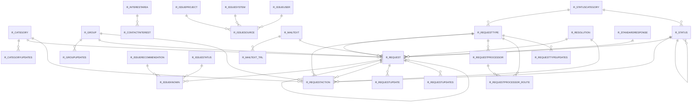

# Area R

28 table(s), 27 in scope.

| table | class | scope | rows | description |
|---|---|---|---|---|
| [R_CATEGORY](../../data-model/r/r_category.md) | business | in | 3 |  |
| [R_CATEGORYUPDATES](../../data-model/r/r_categoryupdates.md) | business | in | 1 |  |
| [R_CONTACTINTEREST](../../data-model/r/r_contactinterest.md) | business | in | 1 |  |
| [R_GROUP](../../data-model/r/r_group.md) | business | in | 2 |  |
| [R_GROUPUPDATES](../../data-model/r/r_groupupdates.md) | business | in | 1 |  |
| [R_INTERESTAREA](../../data-model/r/r_interestarea.md) | business | in | 2 |  |
| [R_ISSUEKNOWN](../../data-model/r/r_issueknown.md) | business | in | 0 |  |
| [R_ISSUEPROJECT](../../data-model/r/r_issueproject.md) | business | in | 0 |  |
| [R_ISSUERECOMMENDATION](../../data-model/r/r_issuerecommendation.md) | business | in | 0 |  |
| [R_ISSUESOURCE](../../data-model/r/r_issuesource.md) | business | in | 0 |  |
| [R_ISSUESTATUS](../../data-model/r/r_issuestatus.md) | business | in | 0 |  |
| [R_ISSUESYSTEM](../../data-model/r/r_issuesystem.md) | business | in | 0 |  |
| [R_ISSUEUSER](../../data-model/r/r_issueuser.md) | business | in | 0 |  |
| [R_MAILTEXT](../../data-model/r/r_mailtext.md) | business | in | 3 |  |
| [R_MAILTEXT_TRL](../../data-model/r/r_mailtext_trl.md) | translation | in | 3 |  |
| [R_REQUEST](../../data-model/r/r_request.md) | business | in | 1 |  |
| [R_REQUESTACTION](../../data-model/r/r_requestaction.md) | business | in | 2 |  |
| [R_REQUESTPROCESSOR](../../data-model/r/r_requestprocessor.md) | business | in | 1 |  |
| `R_REQUESTPROCESSORLOG` | log | out | 0 |  |
| [R_REQUESTPROCESSOR_ROUTE](../../data-model/r/r_requestprocessor_route.md) | business | in | 1 |  |
| [R_REQUESTTYPE](../../data-model/r/r_requesttype.md) | business | in | 3 |  |
| [R_REQUESTTYPEUPDATES](../../data-model/r/r_requesttypeupdates.md) | business | in | 1 |  |
| [R_REQUESTUPDATE](../../data-model/r/r_requestupdate.md) | business | in | 1 |  |
| [R_REQUESTUPDATES](../../data-model/r/r_requestupdates.md) | business | in | 0 |  |
| [R_RESOLUTION](../../data-model/r/r_resolution.md) | business | in | 3 |  |
| [R_STANDARDRESPONSE](../../data-model/r/r_standardresponse.md) | business | in | 1 |  |
| [R_STATUS](../../data-model/r/r_status.md) | business | in | 4 |  |
| [R_STATUSCATEGORY](../../data-model/r/r_statuscategory.md) | business | in | 1 |  |
