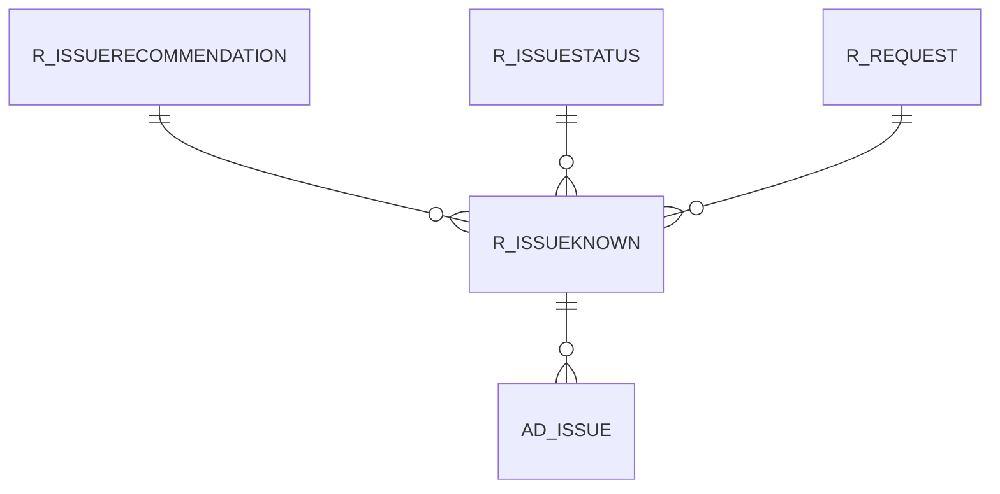

# R_ISSUEKNOWN

Area [R](../../data-model/r/index.md) · class **business** (proposed) · read from database `idempiere-db` (owner `ADEMPIERE`) · 0 row(s) when profiled

Application model: `org.compiere.model.X_R_IssueKnown`, access level 6 - System - Client.

## Columns

| column | type | key | not null | business name | references (code) | nulls | distinct |
|---|---|---|---|---|---|---|---|
| `R_ISSUEKNOWN_ID` | NUMBER(10,0) | PK | yes | Known Issue |  | 0 | 0 |
| `AD_CLIENT_ID` | NUMBER(10,0) |  | yes | Tenant |  | 0 | 0 |
| `AD_ORG_ID` | NUMBER(10,0) |  | yes | Organization |  | 0 | 0 |
| `ISACTIVE` | CHAR(1) |  | yes | Active |  | 0 | 0 |
| `CREATED` | DATE |  | yes | Created |  | 0 | 0 |
| `CREATEDBY` | NUMBER(10,0) |  | yes | Created By |  | 0 | 0 |
| `UPDATED` | DATE |  | yes | Updated |  | 0 | 0 |
| `UPDATEDBY` | NUMBER(10,0) |  | yes | Updated By |  | 0 | 0 |
| `ISSUESUMMARY` | VARCHAR2(255 CHAR) |  | yes | Issue Summary |  | 0 | 0 |
| `RELEASENO` | VARCHAR2(10 CHAR) |  | yes | Release No |  | 0 | 0 |
| `SOURCECLASSNAME` | VARCHAR2(60 CHAR) |  |  | Source Class |  | 0 | 0 |
| `SOURCEMETHODNAME` | VARCHAR2(60 CHAR) |  |  | Source Method |  | 0 | 0 |
| `LOGGERNAME` | VARCHAR2(60 CHAR) |  |  | Logger |  | 0 | 0 |
| `LINENO` | NUMBER(10,0) |  |  | Line |  | 0 | 0 |
| `DESCRIPTION` | VARCHAR2(255 CHAR) |  |  | Description |  | 0 | 0 |
| `ISSUESTATUS` | VARCHAR2(2000 CHAR) |  |  | Issue Status |  | 0 | 0 |
| `R_ISSUESTATUS_ID` | NUMBER(10,0) |  |  | Issue Status | [R_ISSUESTATUS](../../data-model/r/r_issuestatus.md) | 0 | 0 |
| `R_REQUEST_ID` | NUMBER(10,0) |  |  | Request | [R_REQUEST](../../data-model/r/r_request.md) | 0 | 0 |
| `PROCESSING` | CHAR(1) |  |  | Process Now |  | 0 | 0 |
| `R_ISSUERECOMMENDATION_ID` | NUMBER(10,0) |  |  | Issue Recommendation | [R_ISSUERECOMMENDATION](../../data-model/r/r_issuerecommendation.md) | 0 | 0 |
| `R_ISSUEKNOWN_UU` | VARCHAR2(36 CHAR) |  |  | R_IssueKnown_UU |  | 0 | 0 |

*references (code)* is the table the application model's code says a column points to; *Foreign keys* below are the constraints the database declares. Counts come from the profile; no value is ever shown.

## Check constraints

| name | expression |
|---|---|
| `SYS_C0020955` | `IsActive in ('Y','N')` |

## Foreign keys

**References**

| table | columns | on delete |
|---|---|---|
| [R_ISSUERECOMMENDATION](../../data-model/r/r_issuerecommendation.md) | R_ISSUEKNOWN.R_ISSUERECOMMENDATION_ID → R_ISSUERECOMMENDATION.R_ISSUERECOMMENDATION_ID | NO ACTION |
| [R_ISSUESTATUS](../../data-model/r/r_issuestatus.md) | R_ISSUEKNOWN.R_ISSUESTATUS_ID → R_ISSUESTATUS.R_ISSUESTATUS_ID | NO ACTION |
| [R_REQUEST](../../data-model/r/r_request.md) | R_ISSUEKNOWN.R_REQUEST_ID → R_REQUEST.R_REQUEST_ID | NO ACTION |

**Referenced by**

| table | columns | on delete |
|---|---|---|
| [AD_ISSUE](../../data-model/ad/ad_issue.md) | AD_ISSUE.R_ISSUEKNOWN_ID → R_ISSUEKNOWN.R_ISSUEKNOWN_ID | NO ACTION |

## Write behaviour

- updates: **po_only**
- deletes: **deleted_by_users**
- change log: **recorded**
- evidence: 1 citation(s)

## Schema history

37 change(s); the latest:

| applied | release | operation | column | tickets |
|---|---|---|---|---|
| 2023-04-09T15:47 | iD11 | `add_constraint` |  | IDEMPIERE-5567 |
| 2023-04-09T15:47 | iD11 | `add_constraint` |  | IDEMPIERE-5567 |
| 2021-12-05T16:45 | i8.2z | `add_constraint` |  | IDEMPIERE-5075 |
| 2021-12-05T16:45 | i8.2z | `drop_constraint` |  | IDEMPIERE-5075 |
| 2021-12-05T16:45 | i8.2z | `drop_constraint` |  | IDEMPIERE-5075 |
| 2021-12-05T16:45 | i8.2z | `add_constraint` |  | IDEMPIERE-5075 |
| 2021-12-05T16:45 | i8.2z | `drop_constraint` |  | IDEMPIERE-5075 |
| 2021-12-05T16:45 | i8.2z | `add_constraint` |  | IDEMPIERE-5075 |
| 2020-08-04T01:00 | i7.1z | `drop_column` | tmp_col_6_tmp | IDEMPIERE-3862 |
| 2020-08-04T01:00 | i7.1z | `create_index` |  | IDEMPIERE-3862 |
| 2020-08-04T01:00 | i7.1z | `drop_column` | tmp_col_8_tmp | IDEMPIERE-3862 |
| 2020-08-04T01:00 | i7.1z | `modify_column` | ISSUESUMMARY | IDEMPIERE-3862 |
| 2020-08-04T01:00 | i7.1z | `modify_column` | SOURCEMETHODNAME | IDEMPIERE-3862 |
| 2020-08-04T01:00 | i7.1z | `modify_column` | SOURCECLASSNAME | IDEMPIERE-3862 |
| 2020-08-04T01:00 | i7.1z | `add_column` | tmp_col_5_tmp | IDEMPIERE-3862 |

## Notes

<!-- ekos:manual id="table.r_issueknown.notes" -->
_Business notes about this table._
<!-- /ekos:manual -->
