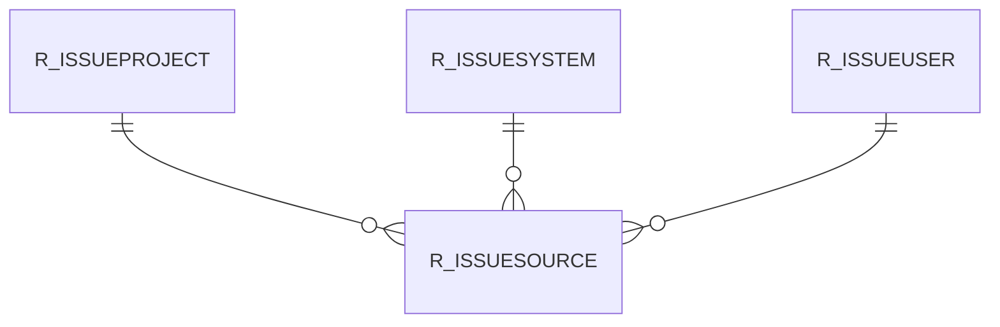

# R_ISSUESOURCE

Area [R](../../data-model/r/index.md) · class **business** (proposed) · read from database `idempiere-db` (owner `ADEMPIERE`) · 0 row(s) when profiled

## Columns

| column | type | key | not null | business name | references (code) | nulls | distinct |
|---|---|---|---|---|---|---|---|
| `R_ISSUESOURCE_ID` | NUMBER(10,0) | PK | yes |  |  | 0 | 0 |
| `AD_CLIENT_ID` | NUMBER(10,0) |  | yes |  |  | 0 | 0 |
| `AD_ORG_ID` | NUMBER(10,0) |  | yes |  |  | 0 | 0 |
| `ISACTIVE` | CHAR(1) |  | yes |  |  | 0 | 0 |
| `CREATED` | DATE |  | yes |  |  | 0 | 0 |
| `CREATEDBY` | NUMBER(10,0) |  | yes |  |  | 0 | 0 |
| `UPDATED` | DATE |  | yes |  |  | 0 | 0 |
| `UPDATEDBY` | NUMBER(10,0) |  | yes |  |  | 0 | 0 |
| `R_ISSUESYSTEM_ID` | NUMBER(10,0) |  | yes |  |  | 0 | 0 |
| `R_ISSUEPROJECT_ID` | NUMBER(10,0) |  | yes |  |  | 0 | 0 |
| `R_ISSUEUSER_ID` | NUMBER(10,0) |  | yes |  |  | 0 | 0 |
| `STATISTICSINFO` | VARCHAR2(60 CHAR) |  |  |  |  | 0 | 0 |
| `PROFILEINFO` | VARCHAR2(60 CHAR) |  |  |  |  | 0 | 0 |

*references (code)* is the table the application model's code says a column points to; *Foreign keys* below are the constraints the database declares. Counts come from the profile; no value is ever shown.

## Check constraints

| name | expression |
|---|---|
| `SYS_C0022603` | `IsActive in ('Y','N')` |

## Foreign keys

**References**

| table | columns | on delete |
|---|---|---|
| [R_ISSUEPROJECT](../../data-model/r/r_issueproject.md) | R_ISSUESOURCE.R_ISSUEPROJECT_ID → R_ISSUEPROJECT.R_ISSUEPROJECT_ID | NO ACTION |
| [R_ISSUESYSTEM](../../data-model/r/r_issuesystem.md) | R_ISSUESOURCE.R_ISSUESYSTEM_ID → R_ISSUESYSTEM.R_ISSUESYSTEM_ID | NO ACTION |
| [R_ISSUEUSER](../../data-model/r/r_issueuser.md) | R_ISSUESOURCE.R_ISSUEUSER_ID → R_ISSUEUSER.R_ISSUEUSER_ID | NO ACTION |

**Referenced by**

_None._

## Write behaviour

- updates: **po_only**
- deletes: **never_deleted_in_code**
- change log: **unknown**
- evidence: 0 citation(s)

## Schema history

12 change(s); the latest:

| applied | release | operation | column | tickets |
|---|---|---|---|---|
| 2021-12-05T16:45 | i8.2z | `add_constraint` |  | IDEMPIERE-5075 |
| 2021-12-05T16:45 | i8.2z | `add_constraint` |  | IDEMPIERE-5075 |
| 2021-12-05T16:45 | i8.2z | `drop_constraint` |  | IDEMPIERE-5075 |
| 2021-12-05T16:45 | i8.2z | `drop_constraint` |  | IDEMPIERE-5075 |
| 2021-12-05T16:45 | i8.2z | `drop_constraint` |  | IDEMPIERE-5075 |
| 2021-12-05T16:45 | i8.2z | `add_constraint` |  | IDEMPIERE-5075 |
| 2020-08-04T01:00 | i7.1z | `modify_column` | PROFILEINFO | IDEMPIERE-3862 |
| 2020-08-04T01:00 | i7.1z | `drop_column` | tmp_col_2_tmp | IDEMPIERE-3862 |
| 2020-08-04T01:00 | i7.1z | `modify_column` | STATISTICSINFO | IDEMPIERE-3862 |
| 2020-08-04T01:00 | i7.1z | `add_column` | tmp_col_2_tmp | IDEMPIERE-3862 |
| 2020-08-04T01:00 | i7.1z | `drop_column` | tmp_col_1_tmp | IDEMPIERE-3862 |
| 2020-08-04T01:00 | i7.1z | `add_column` | tmp_col_1_tmp | IDEMPIERE-3862 |

## Open conflicts

| type | attribute | explanation |
|---|---|---|
| `table_without_model` | `model_class` | unexplained |

## Notes

<!-- ekos:manual id="table.r_issuesource.notes" -->
_Business notes about this table._
<!-- /ekos:manual -->
