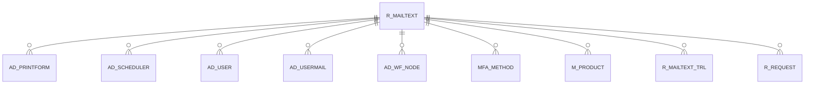

# R_MAILTEXT

Area [R](../../data-model/r/index.md) · class **business** (proposed) · read from database `idempiere-db` (owner `ADEMPIERE`) · 3 row(s) when profiled

Application model: `org.compiere.model.X_R_MailText`, access level 7 - System - Client - Org.

## Columns

| column | type | key | not null | business name | references (code) | nulls | distinct |
|---|---|---|---|---|---|---|---|
| `R_MAILTEXT_ID` | NUMBER(10,0) | PK | yes | Mail Template |  | 0 | 3 |
| `AD_CLIENT_ID` | NUMBER(10,0) |  | yes | Tenant |  | 0 | 2 |
| `AD_ORG_ID` | NUMBER(10,0) |  | yes | Organization |  | 0 | 2 |
| `ISACTIVE` | CHAR(1) |  | yes | Active |  | 0 | 1 |
| `CREATED` | DATE |  | yes | Created |  | 0 | 3 |
| `CREATEDBY` | NUMBER(10,0) |  | yes | Created By |  | 0 | 1 |
| `UPDATED` | DATE |  | yes | Updated |  | 0 | 3 |
| `UPDATEDBY` | NUMBER(10,0) |  | yes | Updated By |  | 0 | 2 |
| `NAME` | VARCHAR2(60 CHAR) |  | yes | Name |  | 0 | 3 |
| `ISHTML` | CHAR(1) |  | yes | HTML |  | 0 | 2 |
| `MAILHEADER` | VARCHAR2(2000 CHAR) |  |  | Subject |  | 0 | 3 |
| `MAILTEXT2` | VARCHAR2(2000 CHAR) |  |  | Mail Text 2 |  | 3 | 0 |
| `MAILTEXT3` | VARCHAR2(2000 CHAR) |  |  | Mail Text 3 |  | 3 | 0 |
| `R_MAILTEXT_UU` | VARCHAR2(36 CHAR) |  |  | R_MailText_UU |  | 0 | 3 |
| `MAILTEXT` | CLOB |  |  | Mail Text |  | 0 | 0 |

*references (code)* is the table the application model's code says a column points to; *Foreign keys* below are the constraints the database declares. Counts come from the profile; no value is ever shown.

## Check constraints

| name | expression |
|---|---|
| `SYS_C0019457` | `IsHTML in ('Y','N')` |
| `SYS_C0019459` | `IsActive in ('Y','N')` |

## Foreign keys

**References**

_None._

**Referenced by**

| table | columns | on delete |
|---|---|---|
| [AD_PRINTFORM](../../data-model/ad/ad_printform.md) | AD_PRINTFORM.DISTRIB_ORDER_MAILTEXT_ID → R_MAILTEXT.R_MAILTEXT_ID | NO ACTION |
| [AD_SCHEDULER](../../data-model/ad/ad_scheduler.md) | AD_SCHEDULER.R_MAILTEXT_ID → R_MAILTEXT.R_MAILTEXT_ID | NO ACTION |
| [AD_USER](../../data-model/ad/ad_user.md) | AD_USER.R_DEFAULTMAILTEXT_ID → R_MAILTEXT.R_MAILTEXT_ID | NO ACTION |
| [AD_USERMAIL](../../data-model/ad/ad_usermail.md) | AD_USERMAIL.R_MAILTEXT_ID → R_MAILTEXT.R_MAILTEXT_ID | CASCADE |
| [AD_WF_NODE](../../data-model/ad/ad_wf_node.md) | AD_WF_NODE.R_MAILTEXT_ID → R_MAILTEXT.R_MAILTEXT_ID | NO ACTION |
| [MFA_METHOD](../../data-model/mfa/mfa_method.md) | MFA_METHOD.R_MAILTEXT_ID → R_MAILTEXT.R_MAILTEXT_ID | NO ACTION |
| [M_PRODUCT](../../data-model/m/m_product.md) | M_PRODUCT.R_MAILTEXT_ID → R_MAILTEXT.R_MAILTEXT_ID | NO ACTION |
| [R_MAILTEXT_TRL](../../data-model/r/r_mailtext_trl.md) | R_MAILTEXT_TRL.R_MAILTEXT_ID → R_MAILTEXT.R_MAILTEXT_ID | CASCADE |
| [R_REQUEST](../../data-model/r/r_request.md) | R_REQUEST.R_MAILTEXT_ID → R_MAILTEXT.R_MAILTEXT_ID | NO ACTION |

## Write behaviour

- updates: **po_only**
- deletes: **deleted_by_users**
- change log: **recorded**
- evidence: 1 citation(s)

## Schema history

23 change(s); the latest:

| applied | release | operation | column | tickets |
|---|---|---|---|---|
| 2023-04-09T15:47 | iD11 | `add_constraint` |  | IDEMPIERE-5567 |
| 2023-04-09T15:47 | iD11 | `add_constraint` |  | IDEMPIERE-5567 |
| 2020-08-04T01:00 | i7.1z | `add_column` | tmp_col_3_tmp | IDEMPIERE-3862 |
| 2020-08-04T01:00 | i7.1z | `modify_column` | R_MAILTEXT_UU | IDEMPIERE-3862 |
| 2020-08-04T01:00 | i7.1z | `add_column` | tmp_col_5_tmp | IDEMPIERE-3862 |
| 2020-08-04T01:00 | i7.1z | `modify_column` | NAME | IDEMPIERE-3862 |
| 2020-08-04T01:00 | i7.1z | `add_column` | tmp_col_2_tmp | IDEMPIERE-3862 |
| 2020-08-04T01:00 | i7.1z | `modify_column` | MAILTEXT2 | IDEMPIERE-3862 |
| 2020-08-04T01:00 | i7.1z | `drop_column` | tmp_col_3_tmp | IDEMPIERE-3862 |
| 2020-08-04T01:00 | i7.1z | `modify_column` | MAILHEADER | IDEMPIERE-3862 |
| 2020-08-04T01:00 | i7.1z | `drop_column` | tmp_col_2_tmp | IDEMPIERE-3862 |
| 2020-08-04T01:00 | i7.1z | `modify_column` | MAILTEXT3 | IDEMPIERE-3862 |
| 2020-08-04T01:00 | i7.1z | `modify_column` | NAME | IDEMPIERE-3862 |
| 2020-08-04T01:00 | i7.1z | `drop_column` | tmp_col_5_tmp | IDEMPIERE-3862 |
| 2020-08-04T01:00 | i7.1z | `add_column` | tmp_col_1_tmp | IDEMPIERE-3862 |

## Open conflicts

| type | attribute | explanation |
|---|---|---|
| `mandatory_but_nullable` | `columns.MailText.nullable` | unexplained |

## Notes

<!-- ekos:manual id="table.r_mailtext.notes" -->
_Business notes about this table._
<!-- /ekos:manual -->
