# R_REQUEST

Area [R](../../data-model/r/index.md) · class **business** (proposed) · read from database `idempiere-db` (owner `ADEMPIERE`) · 1 row(s) when profiled

Application model: `org.compiere.model.X_R_Request`, access level 7 - System - Client - Org.

## Columns

| column | type | key | not null | business name | references (code) | nulls | distinct |
|---|---|---|---|---|---|---|---|
| `R_REQUEST_ID` | NUMBER(10,0) | PK | yes | Request |  | 0 | 1 |
| `AD_CLIENT_ID` | NUMBER(10,0) |  | yes | Tenant |  | 0 | 1 |
| `AD_ORG_ID` | NUMBER(10,0) |  | yes | Organization |  | 0 | 1 |
| `ISACTIVE` | CHAR(1) |  | yes | Active |  | 0 | 1 |
| `CREATED` | DATE |  | yes | Created |  | 0 | 1 |
| `CREATEDBY` | NUMBER(10,0) |  | yes | Created By |  | 0 | 1 |
| `UPDATED` | DATE |  | yes | Updated |  | 0 | 1 |
| `UPDATEDBY` | NUMBER(10,0) |  | yes | Updated By |  | 0 | 1 |
| `DOCUMENTNO` | VARCHAR2(30 CHAR) |  | yes | Document No |  | 0 | 1 |
| `R_REQUESTTYPE_ID` | NUMBER(10,0) |  | yes | Request Type | [R_REQUESTTYPE](../../data-model/r/r_requesttype.md) | 0 | 1 |
| `R_GROUP_ID` | NUMBER(10,0) |  |  | Group | [R_GROUP](../../data-model/r/r_group.md) | 0 | 1 |
| `R_CATEGORY_ID` | NUMBER(10,0) |  |  | Category | [R_CATEGORY](../../data-model/r/r_category.md) | 0 | 1 |
| `R_STATUS_ID` | NUMBER(10,0) |  |  | Status | [R_STATUS](../../data-model/r/r_status.md) | 0 | 1 |
| `R_RESOLUTION_ID` | NUMBER(10,0) |  |  | Resolution | [R_RESOLUTION](../../data-model/r/r_resolution.md) | 1 | 0 |
| `R_REQUESTRELATED_ID` | NUMBER(10,0) |  |  | Related Request | [R_REQUEST](../../data-model/r/r_request.md) | 1 | 0 |
| `PRIORITY` | CHAR(1) |  | yes | Priority |  | 0 | 1 |
| `PRIORITYUSER` | CHAR(1) |  |  | User Importance |  | 0 | 1 |
| `DUETYPE` | CHAR(1) |  | yes | Due type |  | 0 | 1 |
| `SUMMARY` | VARCHAR2(2000 CHAR) |  | yes | Summary |  | 0 | 1 |
| `CONFIDENTIALTYPE` | CHAR(1) |  | yes | Confidentiality |  | 0 | 1 |
| `ISESCALATED` | CHAR(1) |  | yes | Escalated |  | 0 | 1 |
| `ISSELFSERVICE` | CHAR(1) |  | yes | Self-Service |  | 0 | 1 |
| `SALESREP_ID` | NUMBER(10,0) |  | yes | Sales Representative | [AD_USER](../../data-model/ad/ad_user.md) | 0 | 1 |
| `AD_ROLE_ID` | NUMBER(10,0) |  |  | Role | [AD_ROLE](../../data-model/ad/ad_role.md) | 1 | 0 |
| `DATELASTACTION` | DATE |  |  | Date Last Action |  | 0 | 1 |
| `DATELASTALERT` | DATE |  |  | Last Alert |  | 1 | 0 |
| `LASTRESULT` | VARCHAR2(2000 CHAR) |  |  | Last Result |  | 1 | 0 |
| `PROCESSED` | CHAR(1) |  | yes | Processed |  | 0 | 1 |
| `ISINVOICED` | CHAR(1) |  | yes | Invoiced |  | 0 | 1 |
| `C_BPARTNER_ID` | NUMBER(10,0) |  |  | Business Partner | [C_BPARTNER](../../data-model/c/c_bpartner.md) | 0 | 1 |
| `AD_USER_ID` | NUMBER(10,0) |  |  | User/Contact | [AD_USER](../../data-model/ad/ad_user.md) | 0 | 1 |
| `C_CAMPAIGN_ID` | NUMBER(10,0) |  |  | Campaign | [C_CAMPAIGN](../../data-model/c/c_campaign.md) | 1 | 0 |
| `C_ORDER_ID` | NUMBER(10,0) |  |  | Order | [C_ORDER](../../data-model/c/c_order.md) | 1 | 0 |
| `C_INVOICE_ID` | NUMBER(10,0) |  |  | Invoice | [C_INVOICE](../../data-model/c/c_invoice.md) | 1 | 0 |
| `C_PAYMENT_ID` | NUMBER(10,0) |  |  | Payment | [C_PAYMENT](../../data-model/c/c_payment.md) | 1 | 0 |
| `M_PRODUCT_ID` | NUMBER(10,0) |  |  | Product | [M_PRODUCT](../../data-model/m/m_product.md) | 1 | 0 |
| `C_PROJECT_ID` | NUMBER(10,0) |  |  | Project | [C_PROJECT](../../data-model/c/c_project.md) | 1 | 0 |
| `A_ASSET_ID` | NUMBER(10,0) |  |  | Asset | [A_ASSET](../../data-model/a/a_asset.md) | 1 | 0 |
| `M_INOUT_ID` | NUMBER(10,0) |  |  | Shipment/Receipt | [M_INOUT](../../data-model/m/m_inout.md) | 1 | 0 |
| `M_RMA_ID` | NUMBER(10,0) |  |  | RMA | [M_RMA](../../data-model/m/m_rma.md) | 1 | 0 |
| `AD_TABLE_ID` | NUMBER(10,0) |  |  | Table | [AD_TABLE](../../data-model/ad/ad_table.md) | 1 | 0 |
| `RECORD_ID` | NUMBER(10,0) |  |  | Record ID |  | 1 | 0 |
| `REQUESTAMT` | NUMBER |  | yes | Request Amount |  | 0 | 1 |
| `R_MAILTEXT_ID` | NUMBER(10,0) |  |  | Mail Template | [R_MAILTEXT](../../data-model/r/r_mailtext.md) | 1 | 0 |
| `RESULT` | VARCHAR2(2000 CHAR) |  |  | Result |  | 1 | 0 |
| `CONFIDENTIALTYPEENTRY` | CHAR(1) |  | yes | Entry Confidentiality |  | 0 | 1 |
| `R_STANDARDRESPONSE_ID` | NUMBER(10,0) |  |  | Standard Response | [R_STANDARDRESPONSE](../../data-model/r/r_standardresponse.md) | 1 | 0 |
| `NEXTACTION` | CHAR(1) |  |  | Next action |  | 0 | 1 |
| `DATENEXTACTION` | DATE |  |  | Date Next Action |  | 1 | 0 |
| `STARTTIME` | DATE |  |  | Start Time |  | 1 | 0 |
| `ENDTIME` | DATE |  |  | End Time |  | 1 | 0 |
| `QTYSPENT` | NUMBER |  |  | Quantity Used |  | 0 | 1 |
| `QTYINVOICED` | NUMBER |  |  | Quantity Invoiced |  | 0 | 1 |
| `M_PRODUCTSPENT_ID` | NUMBER(10,0) |  |  | Product Used | [M_PRODUCT](../../data-model/m/m_product.md) | 1 | 0 |
| `C_ACTIVITY_ID` | NUMBER(10,0) |  |  | Activity | [C_ACTIVITY](../../data-model/c/c_activity.md) | 1 | 0 |
| `STARTDATE` | DATE |  |  | Start Date |  | 1 | 0 |
| `CLOSEDATE` | DATE |  |  | Close Date |  | 1 | 0 |
| `C_INVOICEREQUEST_ID` | NUMBER(10,0) |  |  | Request Invoice | [C_INVOICE](../../data-model/c/c_invoice.md) | 1 | 0 |
| `M_CHANGEREQUEST_ID` | NUMBER(10,0) |  |  | Change Request | [M_CHANGEREQUEST](../../data-model/m/m_changerequest.md) | 1 | 0 |
| `TASKSTATUS` | CHAR(1) |  |  | Task Status |  | 1 | 0 |
| `QTYPLAN` | NUMBER |  |  | Quantity Plan |  | 1 | 0 |
| `DATECOMPLETEPLAN` | DATE |  |  | Complete Plan |  | 1 | 0 |
| `DATESTARTPLAN` | DATE |  |  | Start Plan |  | 1 | 0 |
| `M_FIXCHANGENOTICE_ID` | NUMBER(10,0) |  |  | Fixed in | [M_CHANGENOTICE](../../data-model/m/m_changenotice.md) | 1 | 0 |
| `R_REQUEST_UU` | VARCHAR2(36 CHAR) |  |  | R_Request_UU |  | 0 | 1 |
| `RECORD_UU` | VARCHAR2(36 CHAR) |  |  | Record UUID |  | 1 | 0 |

*references (code)* is the table the application model's code says a column points to; *Foreign keys* below are the constraints the database declares. Counts come from the profile; no value is ever shown.

## Check constraints

| name | expression |
|---|---|
| `SYS_C0021786` | `IsInvoiced in ('Y','N')` |
| `SYS_C0021787` | `IsActive in ('Y','N')` |
| `SYS_C0021789` | `Processed in ('Y','N')` |
| `SYS_C0021791` | `IsSelfService in ('Y','N')` |
| `SYS_C0021792` | `IsEscalated in ('Y','N')` |

## Foreign keys

**References**

| table | columns | on delete |
|---|---|---|
| [AD_ROLE](../../data-model/ad/ad_role.md) | R_REQUEST.AD_ROLE_ID → AD_ROLE.AD_ROLE_ID | NO ACTION |
| [AD_TABLE](../../data-model/ad/ad_table.md) | R_REQUEST.AD_TABLE_ID → AD_TABLE.AD_TABLE_ID | NO ACTION |
| [AD_USER](../../data-model/ad/ad_user.md) | R_REQUEST.SALESREP_ID → AD_USER.AD_USER_ID | NO ACTION |
| [A_ASSET](../../data-model/a/a_asset.md) | R_REQUEST.A_ASSET_ID → A_ASSET.A_ASSET_ID | NO ACTION |
| [C_ACTIVITY](../../data-model/c/c_activity.md) | R_REQUEST.C_ACTIVITY_ID → C_ACTIVITY.C_ACTIVITY_ID | NO ACTION |
| [C_BPARTNER](../../data-model/c/c_bpartner.md) | R_REQUEST.C_BPARTNER_ID → C_BPARTNER.C_BPARTNER_ID | NO ACTION |
| [C_CAMPAIGN](../../data-model/c/c_campaign.md) | R_REQUEST.C_CAMPAIGN_ID → C_CAMPAIGN.C_CAMPAIGN_ID | NO ACTION |
| [C_INVOICE](../../data-model/c/c_invoice.md) | R_REQUEST.C_INVOICEREQUEST_ID → C_INVOICE.C_INVOICE_ID | NO ACTION |
| [C_ORDER](../../data-model/c/c_order.md) | R_REQUEST.C_ORDER_ID → C_ORDER.C_ORDER_ID | NO ACTION |
| [C_PAYMENT](../../data-model/c/c_payment.md) | R_REQUEST.C_PAYMENT_ID → C_PAYMENT.C_PAYMENT_ID | NO ACTION |
| [C_PROJECT](../../data-model/c/c_project.md) | R_REQUEST.C_PROJECT_ID → C_PROJECT.C_PROJECT_ID | NO ACTION |
| [M_CHANGENOTICE](../../data-model/m/m_changenotice.md) | R_REQUEST.M_FIXCHANGENOTICE_ID → M_CHANGENOTICE.M_CHANGENOTICE_ID | NO ACTION |
| [M_CHANGEREQUEST](../../data-model/m/m_changerequest.md) | R_REQUEST.M_CHANGEREQUEST_ID → M_CHANGEREQUEST.M_CHANGEREQUEST_ID | NO ACTION |
| [M_INOUT](../../data-model/m/m_inout.md) | R_REQUEST.M_INOUT_ID → M_INOUT.M_INOUT_ID | NO ACTION |
| [M_PRODUCT](../../data-model/m/m_product.md) | R_REQUEST.M_PRODUCTSPENT_ID → M_PRODUCT.M_PRODUCT_ID | NO ACTION |
| [M_RMA](../../data-model/m/m_rma.md) | R_REQUEST.M_RMA_ID → M_RMA.M_RMA_ID | NO ACTION |
| [R_CATEGORY](../../data-model/r/r_category.md) | R_REQUEST.R_CATEGORY_ID → R_CATEGORY.R_CATEGORY_ID | NO ACTION |
| [R_GROUP](../../data-model/r/r_group.md) | R_REQUEST.R_GROUP_ID → R_GROUP.R_GROUP_ID | NO ACTION |
| [R_MAILTEXT](../../data-model/r/r_mailtext.md) | R_REQUEST.R_MAILTEXT_ID → R_MAILTEXT.R_MAILTEXT_ID | NO ACTION |
| [R_REQUEST](../../data-model/r/r_request.md) | R_REQUEST.R_REQUESTRELATED_ID → R_REQUEST.R_REQUEST_ID | NO ACTION |
| [R_REQUESTTYPE](../../data-model/r/r_requesttype.md) | R_REQUEST.R_REQUESTTYPE_ID → R_REQUESTTYPE.R_REQUESTTYPE_ID | NO ACTION |
| [R_RESOLUTION](../../data-model/r/r_resolution.md) | R_REQUEST.R_RESOLUTION_ID → R_RESOLUTION.R_RESOLUTION_ID | NO ACTION |
| [R_STANDARDRESPONSE](../../data-model/r/r_standardresponse.md) | R_REQUEST.R_STANDARDRESPONSE_ID → R_STANDARDRESPONSE.R_STANDARDRESPONSE_ID | NO ACTION |
| [R_STATUS](../../data-model/r/r_status.md) | R_REQUEST.R_STATUS_ID → R_STATUS.R_STATUS_ID | NO ACTION |

**Referenced by**

| table | columns | on delete |
|---|---|---|
| [AD_ISSUE](../../data-model/ad/ad_issue.md) | AD_ISSUE.R_REQUEST_ID → R_REQUEST.R_REQUEST_ID | SET NULL |
| [R_ISSUEKNOWN](../../data-model/r/r_issueknown.md) | R_ISSUEKNOWN.R_REQUEST_ID → R_REQUEST.R_REQUEST_ID | NO ACTION |
| [R_REQUEST](../../data-model/r/r_request.md) | R_REQUEST.R_REQUESTRELATED_ID → R_REQUEST.R_REQUEST_ID | NO ACTION |
| [R_REQUESTACTION](../../data-model/r/r_requestaction.md) | R_REQUESTACTION.R_REQUEST_ID → R_REQUEST.R_REQUEST_ID | NO ACTION |
| [R_REQUESTUPDATE](../../data-model/r/r_requestupdate.md) | R_REQUESTUPDATE.R_REQUEST_ID → R_REQUEST.R_REQUEST_ID | NO ACTION |
| [R_REQUESTUPDATES](../../data-model/r/r_requestupdates.md) | R_REQUESTUPDATES.R_REQUEST_ID → R_REQUEST.R_REQUEST_ID | NO ACTION |

```mermaid
erDiagram
  AD_ROLE ||--o{ R_REQUEST : ""
  AD_TABLE ||--o{ R_REQUEST : ""
  AD_USER ||--o{ R_REQUEST : ""
  A_ASSET ||--o{ R_REQUEST : ""
  C_ACTIVITY ||--o{ R_REQUEST : ""
  C_BPARTNER ||--o{ R_REQUEST : ""
  C_CAMPAIGN ||--o{ R_REQUEST : ""
  C_INVOICE ||--o{ R_REQUEST : ""
  C_ORDER ||--o{ R_REQUEST : ""
  C_PAYMENT ||--o{ R_REQUEST : ""
  C_PROJECT ||--o{ R_REQUEST : ""
  M_CHANGENOTICE ||--o{ R_REQUEST : ""
  M_CHANGEREQUEST ||--o{ R_REQUEST : ""
  M_INOUT ||--o{ R_REQUEST : ""
  M_PRODUCT ||--o{ R_REQUEST : ""
  M_RMA ||--o{ R_REQUEST : ""
  R_CATEGORY ||--o{ R_REQUEST : ""
  R_GROUP ||--o{ R_REQUEST : ""
  R_MAILTEXT ||--o{ R_REQUEST : ""
  R_REQUEST ||--o{ AD_ISSUE : ""
  R_REQUEST ||--o{ R_ISSUEKNOWN : ""
  R_REQUEST ||--o{ R_REQUEST : ""
  R_REQUEST ||--o{ R_REQUESTACTION : ""
  R_REQUEST ||--o{ R_REQUESTUPDATE : ""
  R_REQUEST ||--o{ R_REQUESTUPDATES : ""
  R_REQUESTTYPE ||--o{ R_REQUEST : ""
  R_RESOLUTION ||--o{ R_REQUEST : ""
  R_STANDARDRESPONSE ||--o{ R_REQUEST : ""
  R_STATUS ||--o{ R_REQUEST : ""
```

## Write behaviour

- updates: **po_only**
- deletes: **deleted_by_users**
- change log: **recorded**
- evidence: 1 citation(s)

## Read by

| kind | name |
|---|---|
| View | `RV_REQUESTUPDATES` |
| View | `R_REQUEST_V` |
| View | `r_request_v` |
| View | `rv_requestupdates` |

## Schema history

91 change(s); the latest:

| applied | release | operation | column | tickets |
|---|---|---|---|---|
| 2026-07-22T13:26 | iD13 | `modify_column` | SalesRep_ID | IDEMPIERE-7065 |
| 2026-07-22T13:26 | iD13 | `modify_column` | SalesRep_ID | IDEMPIERE-7065 |
| 2026-07-22T13:26 | iD13 | `modify_column` | SalesRep_ID | IDEMPIERE-7065 |
| 2026-07-22T13:26 | iD13 | `modify_column` | SalesRep_ID | IDEMPIERE-7065 |
| 2024-05-14T13:59 | iD13 | `add_column` | C_Department_ID | IDEMPIERE-5598 |
| 2024-05-14T13:59 | iD13 | `add_constraint` |  | IDEMPIERE-5598 |
| 2024-05-14T13:59 | iD13 | `add_column` | C_Department_ID | IDEMPIERE-5598 |
| 2024-05-14T13:59 | iD13 | `add_constraint` |  | IDEMPIERE-5598 |
| 2024-05-14T13:59 | iD13 | `add_constraint` |  | IDEMPIERE-5598 |
| 2024-05-14T13:59 | iD13 | `add_column` | C_CostCenter_ID | IDEMPIERE-5598 |
| 2024-05-14T13:59 | iD13 | `add_constraint` |  | IDEMPIERE-5598 |
| 2024-05-14T13:59 | iD13 | `add_column` | C_CostCenter_ID | IDEMPIERE-5598 |
| 2023-06-24T11:43 | iD11 | `create_index` |  |  |
| 2023-06-24T11:43 | iD11 | `add_column` | Record_UU |  |
| 2023-06-24T11:43 | iD11 | `add_column` | Record_UU |  |

## Open conflicts

| type | attribute | explanation |
|---|---|---|
| `model_column_missing` | `columns.C_CostCenter_ID` | unexplained |
| `model_column_missing` | `columns.C_Department_ID` | unexplained |

## Notes

<!-- ekos:manual id="table.r_request.notes" -->
_Business notes about this table._
<!-- /ekos:manual -->
