# R_REQUESTACTION

Area [R](../../data-model/r/index.md) · class **business** (proposed) · read from database `idempiere-db` (owner `ADEMPIERE`) · 2 row(s) when profiled

Application model: `org.compiere.model.X_R_RequestAction`, access level 7 - System - Client - Org.

## Columns

| column | type | key | not null | business name | references (code) | nulls | distinct |
|---|---|---|---|---|---|---|---|
| `R_REQUESTACTION_ID` | NUMBER(10,0) | PK | yes | Request History |  | 0 | 2 |
| `AD_CLIENT_ID` | NUMBER(10,0) |  | yes | Tenant |  | 0 | 1 |
| `AD_ORG_ID` | NUMBER(10,0) |  | yes | Organization |  | 0 | 1 |
| `ISACTIVE` | CHAR(1) |  | yes | Active |  | 0 | 1 |
| `CREATED` | DATE |  | yes | Created |  | 0 | 2 |
| `CREATEDBY` | NUMBER(10,0) |  | yes | Created By |  | 0 | 1 |
| `UPDATED` | DATE |  | yes | Updated |  | 0 | 2 |
| `UPDATEDBY` | NUMBER(10,0) |  | yes | Updated By |  | 0 | 1 |
| `R_REQUEST_ID` | NUMBER(10,0) |  | yes | Request | [R_REQUEST](../../data-model/r/r_request.md) | 0 | 1 |
| `R_GROUP_ID` | NUMBER(10,0) |  |  | Group | [R_GROUP](../../data-model/r/r_group.md) | 1 | 1 |
| `R_CATEGORY_ID` | NUMBER(10,0) |  |  | Category | [R_CATEGORY](../../data-model/r/r_category.md) | 2 | 0 |
| `R_STATUS_ID` | NUMBER(10,0) |  |  | Status | [R_STATUS](../../data-model/r/r_status.md) | 2 | 0 |
| `R_RESOLUTION_ID` | NUMBER(10,0) |  |  | Resolution | [R_RESOLUTION](../../data-model/r/r_resolution.md) | 2 | 0 |
| `SALESREP_ID` | NUMBER(10,0) |  |  | Sales Representative | [AD_USER](../../data-model/ad/ad_user.md) | 2 | 0 |
| `AD_ROLE_ID` | NUMBER(10,0) |  |  | Role | [AD_ROLE](../../data-model/ad/ad_role.md) | 2 | 0 |
| `ISESCALATED` | CHAR(1) |  |  | Escalated |  | 2 | 0 |
| `ISINVOICED` | CHAR(1) |  |  | Invoiced |  | 2 | 0 |
| `CONFIDENTIALTYPE` | CHAR(1) |  |  | Confidentiality |  | 2 | 0 |
| `ISSELFSERVICE` | CHAR(1) |  |  | Self-Service |  | 2 | 0 |
| `PRIORITY` | CHAR(1) |  |  | Priority |  | 2 | 0 |
| `PRIORITYUSER` | CHAR(1) |  |  | User Importance |  | 2 | 0 |
| `C_BPARTNER_ID` | NUMBER(10,0) |  |  | Business Partner | [C_BPARTNER](../../data-model/c/c_bpartner.md) | 2 | 0 |
| `AD_USER_ID` | NUMBER(10,0) |  |  | User/Contact | [AD_USER](../../data-model/ad/ad_user.md) | 2 | 0 |
| `C_ORDER_ID` | NUMBER(10,0) |  |  | Order | [C_ORDER](../../data-model/c/c_order.md) | 2 | 0 |
| `C_INVOICE_ID` | NUMBER(10,0) |  |  | Invoice | [C_INVOICE](../../data-model/c/c_invoice.md) | 2 | 0 |
| `C_PAYMENT_ID` | NUMBER(10,0) |  |  | Payment | [C_PAYMENT](../../data-model/c/c_payment.md) | 2 | 0 |
| `M_PRODUCT_ID` | NUMBER(10,0) |  |  | Product | [M_PRODUCT](../../data-model/m/m_product.md) | 2 | 0 |
| `C_PROJECT_ID` | NUMBER(10,0) |  |  | Project | [C_PROJECT](../../data-model/c/c_project.md) | 2 | 0 |
| `SUMMARY` | VARCHAR2(2000 CHAR) |  |  | Summary |  | 1 | 1 |
| `DATENEXTACTION` | DATE |  |  | Date Next Action |  | 2 | 0 |
| `C_ACTIVITY_ID` | NUMBER(10,0) |  |  | Activity | [C_ACTIVITY](../../data-model/c/c_activity.md) | 2 | 0 |
| `R_REQUESTTYPE_ID` | NUMBER(10,0) |  |  | Request Type | [R_REQUESTTYPE](../../data-model/r/r_requesttype.md) | 1 | 1 |
| `A_ASSET_ID` | NUMBER(10,0) |  |  | Asset | [A_ASSET](../../data-model/a/a_asset.md) | 2 | 0 |
| `M_INOUT_ID` | NUMBER(10,0) |  |  | Shipment/Receipt | [M_INOUT](../../data-model/m/m_inout.md) | 2 | 0 |
| `M_RMA_ID` | NUMBER(10,0) |  |  | RMA | [M_RMA](../../data-model/m/m_rma.md) | 2 | 0 |
| `NULLCOLUMNS` | VARCHAR2(255 CHAR) |  |  | Null Columns |  | 1 | 1 |
| `TASKSTATUS` | CHAR(1) |  |  | Task Status |  | 2 | 0 |
| `DATECOMPLETEPLAN` | DATE |  |  | Complete Plan |  | 2 | 0 |
| `QTYPLAN` | NUMBER |  |  | Quantity Plan |  | 2 | 0 |
| `QTYSPENT` | NUMBER |  |  | Quantity Used |  | 2 | 0 |
| `STARTDATE` | DATE |  |  | Start Date |  | 2 | 0 |
| `ENDDATE` | DATE |  |  | End Date |  | 2 | 0 |
| `DATESTARTPLAN` | DATE |  |  | Start Plan |  | 2 | 0 |
| `QTYINVOICED` | NUMBER |  |  | Quantity Invoiced |  | 2 | 0 |
| `M_PRODUCTSPENT_ID` | NUMBER(10,0) |  |  | Product Used | [M_PRODUCT](../../data-model/m/m_product.md) | 2 | 0 |
| `R_REQUESTACTION_UU` | VARCHAR2(36 CHAR) |  |  | R_RequestAction_UU |  | 0 | 2 |

*references (code)* is the table the application model's code says a column points to; *Foreign keys* below are the constraints the database declares. Counts come from the profile; no value is ever shown.

## Check constraints

| name | expression |
|---|---|
| `SYS_C0019625` | `IsActive in ('Y','N')` |

## Foreign keys

**References**

| table | columns | on delete |
|---|---|---|
| [AD_ROLE](../../data-model/ad/ad_role.md) | R_REQUESTACTION.AD_ROLE_ID → AD_ROLE.AD_ROLE_ID | NO ACTION |
| [AD_USER](../../data-model/ad/ad_user.md) | R_REQUESTACTION.SALESREP_ID → AD_USER.AD_USER_ID | NO ACTION |
| [A_ASSET](../../data-model/a/a_asset.md) | R_REQUESTACTION.A_ASSET_ID → A_ASSET.A_ASSET_ID | NO ACTION |
| [C_ACTIVITY](../../data-model/c/c_activity.md) | R_REQUESTACTION.C_ACTIVITY_ID → C_ACTIVITY.C_ACTIVITY_ID | NO ACTION |
| [C_BPARTNER](../../data-model/c/c_bpartner.md) | R_REQUESTACTION.C_BPARTNER_ID → C_BPARTNER.C_BPARTNER_ID | NO ACTION |
| [C_INVOICE](../../data-model/c/c_invoice.md) | R_REQUESTACTION.C_INVOICE_ID → C_INVOICE.C_INVOICE_ID | NO ACTION |
| [C_ORDER](../../data-model/c/c_order.md) | R_REQUESTACTION.C_ORDER_ID → C_ORDER.C_ORDER_ID | NO ACTION |
| [C_PAYMENT](../../data-model/c/c_payment.md) | R_REQUESTACTION.C_PAYMENT_ID → C_PAYMENT.C_PAYMENT_ID | NO ACTION |
| [C_PROJECT](../../data-model/c/c_project.md) | R_REQUESTACTION.C_PROJECT_ID → C_PROJECT.C_PROJECT_ID | NO ACTION |
| [M_INOUT](../../data-model/m/m_inout.md) | R_REQUESTACTION.M_INOUT_ID → M_INOUT.M_INOUT_ID | NO ACTION |
| [M_PRODUCT](../../data-model/m/m_product.md) | R_REQUESTACTION.M_PRODUCTSPENT_ID → M_PRODUCT.M_PRODUCT_ID | NO ACTION |
| [M_RMA](../../data-model/m/m_rma.md) | R_REQUESTACTION.M_RMA_ID → M_RMA.M_RMA_ID | NO ACTION |
| [R_CATEGORY](../../data-model/r/r_category.md) | R_REQUESTACTION.R_CATEGORY_ID → R_CATEGORY.R_CATEGORY_ID | NO ACTION |
| [R_GROUP](../../data-model/r/r_group.md) | R_REQUESTACTION.R_GROUP_ID → R_GROUP.R_GROUP_ID | NO ACTION |
| [R_REQUEST](../../data-model/r/r_request.md) | R_REQUESTACTION.R_REQUEST_ID → R_REQUEST.R_REQUEST_ID | NO ACTION |
| [R_REQUESTTYPE](../../data-model/r/r_requesttype.md) | R_REQUESTACTION.R_REQUESTTYPE_ID → R_REQUESTTYPE.R_REQUESTTYPE_ID | NO ACTION |
| [R_RESOLUTION](../../data-model/r/r_resolution.md) | R_REQUESTACTION.R_RESOLUTION_ID → R_RESOLUTION.R_RESOLUTION_ID | NO ACTION |
| [R_STATUS](../../data-model/r/r_status.md) | R_REQUESTACTION.R_STATUS_ID → R_STATUS.R_STATUS_ID | NO ACTION |

**Referenced by**

_None._

```mermaid
erDiagram
  AD_ROLE ||--o{ R_REQUESTACTION : ""
  AD_USER ||--o{ R_REQUESTACTION : ""
  A_ASSET ||--o{ R_REQUESTACTION : ""
  C_ACTIVITY ||--o{ R_REQUESTACTION : ""
  C_BPARTNER ||--o{ R_REQUESTACTION : ""
  C_INVOICE ||--o{ R_REQUESTACTION : ""
  C_ORDER ||--o{ R_REQUESTACTION : ""
  C_PAYMENT ||--o{ R_REQUESTACTION : ""
  C_PROJECT ||--o{ R_REQUESTACTION : ""
  M_INOUT ||--o{ R_REQUESTACTION : ""
  M_PRODUCT ||--o{ R_REQUESTACTION : ""
  M_RMA ||--o{ R_REQUESTACTION : ""
  R_CATEGORY ||--o{ R_REQUESTACTION : ""
  R_GROUP ||--o{ R_REQUESTACTION : ""
  R_REQUEST ||--o{ R_REQUESTACTION : ""
  R_REQUESTTYPE ||--o{ R_REQUESTACTION : ""
  R_RESOLUTION ||--o{ R_REQUESTACTION : ""
  R_STATUS ||--o{ R_REQUESTACTION : ""
```

## Write behaviour

- updates: **po_only**
- deletes: **deleted_by_users**
- change log: **recorded**
- evidence: 1 citation(s)

## Schema history

51 change(s); the latest:

| applied | release | operation | column | tickets |
|---|---|---|---|---|
| 2023-04-09T15:47 | iD11 | `add_constraint` |  | IDEMPIERE-5567 |
| 2023-04-09T15:47 | iD11 | `add_constraint` |  | IDEMPIERE-5567 |
| 2021-12-05T16:45 | i8.2z | `drop_constraint` |  | IDEMPIERE-5075 |
| 2021-12-05T16:45 | i8.2z | `drop_constraint` |  | IDEMPIERE-5075 |
| 2021-12-05T16:45 | i8.2z | `drop_constraint` |  | IDEMPIERE-5075 |
| 2021-12-05T16:45 | i8.2z | `add_constraint` |  | IDEMPIERE-5075 |
| 2021-12-05T16:45 | i8.2z | `drop_constraint` |  | IDEMPIERE-5075 |
| 2021-12-05T16:45 | i8.2z | `drop_constraint` |  | IDEMPIERE-5075 |
| 2021-12-05T16:45 | i8.2z | `drop_constraint` |  | IDEMPIERE-5075 |
| 2021-12-05T16:45 | i8.2z | `drop_constraint` |  | IDEMPIERE-5075 |
| 2021-12-05T16:45 | i8.2z | `drop_constraint` |  | IDEMPIERE-5075 |
| 2021-12-05T16:45 | i8.2z | `add_constraint` |  | IDEMPIERE-5075 |
| 2021-12-05T16:45 | i8.2z | `add_constraint` |  | IDEMPIERE-5075 |
| 2021-12-05T16:45 | i8.2z | `add_constraint` |  | IDEMPIERE-5075 |
| 2021-12-05T16:45 | i8.2z | `add_constraint` |  | IDEMPIERE-5075 |

## Notes

<!-- ekos:manual id="table.r_requestaction.notes" -->
_Business notes about this table._
<!-- /ekos:manual -->
