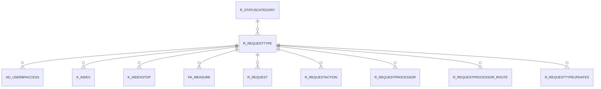

# R_REQUESTTYPE

Area [R](../../data-model/r/index.md) · class **business** (proposed) · read from database `idempiere-db` (owner `ADEMPIERE`) · 3 row(s) when profiled

Application model: `org.compiere.model.X_R_RequestType`, access level 6 - System - Client.

## Columns

| column | type | key | not null | business name | references (code) | nulls | distinct |
|---|---|---|---|---|---|---|---|
| `R_REQUESTTYPE_ID` | NUMBER(10,0) | PK | yes | Request Type |  | 0 | 3 |
| `AD_CLIENT_ID` | NUMBER(10,0) |  | yes | Tenant |  | 0 | 1 |
| `AD_ORG_ID` | NUMBER(10,0) |  | yes | Organization |  | 0 | 1 |
| `ISACTIVE` | CHAR(1) |  | yes | Active |  | 0 | 1 |
| `CREATED` | DATE |  | yes | Created |  | 0 | 3 |
| `CREATEDBY` | NUMBER(10,0) |  | yes | Created By |  | 0 | 1 |
| `UPDATED` | DATE |  | yes | Updated |  | 0 | 3 |
| `UPDATEDBY` | NUMBER(10,0) |  | yes | Updated By |  | 0 | 1 |
| `NAME` | VARCHAR2(60 CHAR) |  | yes | Name |  | 0 | 3 |
| `DESCRIPTION` | VARCHAR2(255 CHAR) |  |  | Description |  | 3 | 0 |
| `ISDEFAULT` | CHAR(1) |  | yes | Default |  | 0 | 1 |
| `ISSELFSERVICE` | CHAR(1) |  | yes | Self-Service |  | 0 | 1 |
| `DUEDATETOLERANCE` | NUMBER(10,0) |  | yes | Due Date Tolerance |  | 0 | 1 |
| `ISEMAILWHENOVERDUE` | CHAR(1) |  | yes | EMail when Overdue |  | 0 | 1 |
| `ISEMAILWHENDUE` | CHAR(1) |  | yes | EMail when Due |  | 0 | 1 |
| `ISINVOICED` | CHAR(1) |  |  | Invoiced |  | 0 | 1 |
| `AUTODUEDATEDAYS` | NUMBER(10,0) |  |  | Auto Due Date Days |  | 3 | 0 |
| `CONFIDENTIALTYPE` | CHAR(1) |  | yes | Confidentiality |  | 0 | 1 |
| `ISAUTOCHANGEREQUEST` | CHAR(1) |  | yes | Create Change Request |  | 0 | 1 |
| `ISCONFIDENTIALINFO` | CHAR(1) |  | yes | Confidential Info |  | 0 | 1 |
| `R_STATUSCATEGORY_ID` | NUMBER(10,0) |  | yes | Status Category | [R_STATUSCATEGORY](../../data-model/r/r_statuscategory.md) | 0 | 1 |
| `ISINDEXED` | CHAR(1) |  | yes | Indexed |  | 0 | 1 |
| `R_REQUESTTYPE_UU` | VARCHAR2(36 CHAR) |  |  | R_RequestType_UU |  | 0 | 3 |
| `HEADERCOLOR` | VARCHAR2(7 CHAR) |  |  | Header Color |  | 3 | 0 |
| `CONTENTCOLOR` | VARCHAR2(7 CHAR) |  |  | Content Color |  | 3 | 0 |

*references (code)* is the table the application model's code says a column points to; *Foreign keys* below are the constraints the database declares. Counts come from the profile; no value is ever shown.

## Check constraints

| name | expression |
|---|---|
| `SYS_C0020631` | `IsActive in ('Y','N')` |

## Foreign keys

**References**

| table | columns | on delete |
|---|---|---|
| [R_STATUSCATEGORY](../../data-model/r/r_statuscategory.md) | R_REQUESTTYPE.R_STATUSCATEGORY_ID → R_STATUSCATEGORY.R_STATUSCATEGORY_ID | NO ACTION |

**Referenced by**

| table | columns | on delete |
|---|---|---|
| [AD_USERBPACCESS](../../data-model/ad/ad_userbpaccess.md) | AD_USERBPACCESS.R_REQUESTTYPE_ID → R_REQUESTTYPE.R_REQUESTTYPE_ID | CASCADE |
| [K_INDEX](../../data-model/k/k_index.md) | K_INDEX.R_REQUESTTYPE_ID → R_REQUESTTYPE.R_REQUESTTYPE_ID | CASCADE |
| [K_INDEXSTOP](../../data-model/k/k_indexstop.md) | K_INDEXSTOP.R_REQUESTTYPE_ID → R_REQUESTTYPE.R_REQUESTTYPE_ID | CASCADE |
| [PA_MEASURE](../../data-model/pa/pa_measure.md) | PA_MEASURE.R_REQUESTTYPE_ID → R_REQUESTTYPE.R_REQUESTTYPE_ID | NO ACTION |
| [R_REQUEST](../../data-model/r/r_request.md) | R_REQUEST.R_REQUESTTYPE_ID → R_REQUESTTYPE.R_REQUESTTYPE_ID | NO ACTION |
| [R_REQUESTACTION](../../data-model/r/r_requestaction.md) | R_REQUESTACTION.R_REQUESTTYPE_ID → R_REQUESTTYPE.R_REQUESTTYPE_ID | NO ACTION |
| [R_REQUESTPROCESSOR](../../data-model/r/r_requestprocessor.md) | R_REQUESTPROCESSOR.R_REQUESTTYPE_ID → R_REQUESTTYPE.R_REQUESTTYPE_ID | NO ACTION |
| [R_REQUESTPROCESSOR_ROUTE](../../data-model/r/r_requestprocessor_route.md) | R_REQUESTPROCESSOR_ROUTE.R_REQUESTTYPE_ID → R_REQUESTTYPE.R_REQUESTTYPE_ID | NO ACTION |
| [R_REQUESTTYPEUPDATES](../../data-model/r/r_requesttypeupdates.md) | R_REQUESTTYPEUPDATES.R_REQUESTTYPE_ID → R_REQUESTTYPE.R_REQUESTTYPE_ID | NO ACTION |

## Write behaviour

- updates: **po_only**
- deletes: **deleted_by_users**
- change log: **recorded**
- evidence: 1 citation(s)

## Schema history

21 change(s); the latest:

| applied | release | operation | column | tickets |
|---|---|---|---|---|
| 2023-04-09T15:47 | iD11 | `add_constraint` |  | IDEMPIERE-5567 |
| 2023-04-09T15:47 | iD11 | `add_constraint` |  | IDEMPIERE-5567 |
| 2021-12-05T16:45 | i8.2z | `drop_constraint` |  | IDEMPIERE-5075 |
| 2021-12-05T16:45 | i8.2z | `add_constraint` |  | IDEMPIERE-5075 |
| 2020-08-04T01:00 | i7.1z | `drop_column` | tmp_col_2_tmp | IDEMPIERE-3862 |
| 2020-08-04T01:00 | i7.1z | `modify_column` | HEADERCOLOR | IDEMPIERE-3862 |
| 2020-08-04T01:00 | i7.1z | `drop_column` | tmp_col_1_tmp | IDEMPIERE-3862 |
| 2020-08-04T01:00 | i7.1z | `modify_column` | NAME | IDEMPIERE-3862 |
| 2020-08-04T01:00 | i7.1z | `modify_column` | DESCRIPTION | IDEMPIERE-3862 |
| 2020-08-04T01:00 | i7.1z | `add_column` | tmp_col_1_tmp | IDEMPIERE-3862 |
| 2020-08-04T01:00 | i7.1z | `modify_column` | NAME | IDEMPIERE-3862 |
| 2020-08-04T01:00 | i7.1z | `modify_column` | R_REQUESTTYPE_UU | IDEMPIERE-3862 |
| 2020-08-04T01:00 | i7.1z | `add_column` | tmp_col_3_tmp | IDEMPIERE-3862 |
| 2020-08-04T01:00 | i7.1z | `modify_column` | CONTENTCOLOR | IDEMPIERE-3862 |
| 2020-08-04T01:00 | i7.1z | `drop_column` | tmp_col_4_tmp | IDEMPIERE-3862 |

## Notes

<!-- ekos:manual id="table.r_requesttype.notes" -->
_Business notes about this table._
<!-- /ekos:manual -->
