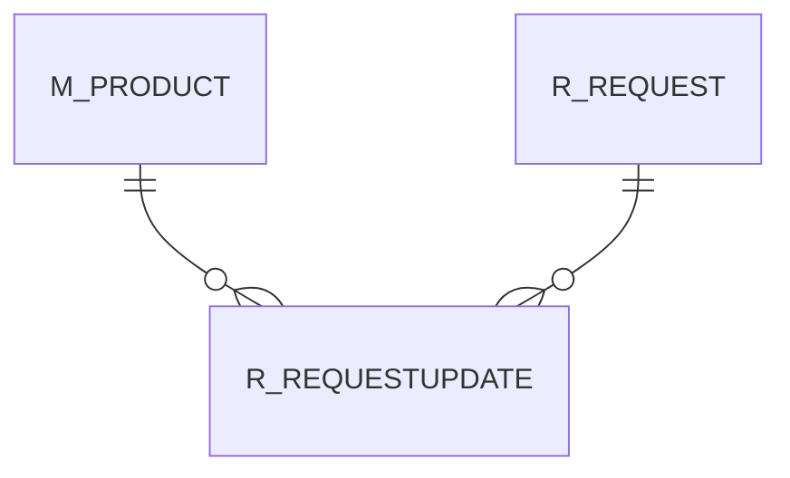

# R_REQUESTUPDATE

Area [R](../../data-model/r/index.md) · class **business** (proposed) · read from database `idempiere-db` (owner `ADEMPIERE`) · 1 row(s) when profiled

Application model: `org.compiere.model.X_R_RequestUpdate`, access level 7 - System - Client - Org.

## Columns

| column | type | key | not null | business name | references (code) | nulls | distinct |
|---|---|---|---|---|---|---|---|
| `R_REQUESTUPDATE_ID` | NUMBER(10,0) | PK | yes | Request Update |  | 0 | 1 |
| `AD_CLIENT_ID` | NUMBER(10,0) |  | yes | Tenant |  | 0 | 1 |
| `AD_ORG_ID` | NUMBER(10,0) |  | yes | Organization |  | 0 | 1 |
| `ISACTIVE` | CHAR(1) |  | yes | Active |  | 0 | 1 |
| `CREATED` | DATE |  | yes | Created |  | 0 | 1 |
| `CREATEDBY` | NUMBER(10,0) |  | yes | Created By |  | 0 | 1 |
| `UPDATED` | DATE |  | yes | Updated |  | 0 | 1 |
| `UPDATEDBY` | NUMBER(10,0) |  | yes | Updated By |  | 0 | 1 |
| `R_REQUEST_ID` | NUMBER(10,0) |  | yes | Request | [R_REQUEST](../../data-model/r/r_request.md) | 0 | 1 |
| `CONFIDENTIALTYPEENTRY` | CHAR(1) |  | yes | Entry Confidentiality |  | 0 | 1 |
| `STARTTIME` | DATE |  |  | Start Time |  | 1 | 0 |
| `ENDTIME` | DATE |  |  | End Time |  | 1 | 0 |
| `QTYSPENT` | NUMBER |  |  | Quantity Used |  | 0 | 1 |
| `QTYINVOICED` | NUMBER |  |  | Quantity Invoiced |  | 0 | 1 |
| `M_PRODUCTSPENT_ID` | NUMBER(10,0) |  |  | Product Used | [M_PRODUCT](../../data-model/m/m_product.md) | 1 | 0 |
| `RESULT` | VARCHAR2(2000 CHAR) |  |  | Result |  | 0 | 1 |
| `R_REQUESTUPDATE_UU` | VARCHAR2(36 CHAR) |  |  | R_RequestUpdate_UU |  | 0 | 1 |

*references (code)* is the table the application model's code says a column points to; *Foreign keys* below are the constraints the database declares. Counts come from the profile; no value is ever shown.

## Check constraints

| name | expression |
|---|---|
| `SYS_C0021086` | `IsActive in ('Y','N')` |

## Foreign keys

**References**

| table | columns | on delete |
|---|---|---|
| [M_PRODUCT](../../data-model/m/m_product.md) | R_REQUESTUPDATE.M_PRODUCTSPENT_ID → M_PRODUCT.M_PRODUCT_ID | NO ACTION |
| [R_REQUEST](../../data-model/r/r_request.md) | R_REQUESTUPDATE.R_REQUEST_ID → R_REQUEST.R_REQUEST_ID | NO ACTION |

**Referenced by**

_None._

## Write behaviour

- updates: **po_only**
- deletes: **deleted_by_users**
- change log: **recorded**
- evidence: 1 citation(s)

## Schema history

12 change(s); the latest:

| applied | release | operation | column | tickets |
|---|---|---|---|---|
| 2023-04-09T15:47 | iD11 | `add_constraint` |  | IDEMPIERE-5567 |
| 2023-04-09T15:47 | iD11 | `add_constraint` |  | IDEMPIERE-5567 |
| 2021-12-05T16:45 | i8.2z | `add_constraint` |  | IDEMPIERE-5075 |
| 2021-12-05T16:45 | i8.2z | `drop_constraint` |  | IDEMPIERE-5075 |
| 2021-12-05T16:45 | i8.2z | `add_constraint` |  | IDEMPIERE-5075 |
| 2021-12-05T16:45 | i8.2z | `drop_constraint` |  | IDEMPIERE-5075 |
| 2020-08-04T01:00 | i7.1z | `drop_column` | tmp_col_2_tmp | IDEMPIERE-3862 |
| 2020-08-04T01:00 | i7.1z | `drop_column` | tmp_col_1_tmp | IDEMPIERE-3862 |
| 2020-08-04T01:00 | i7.1z | `modify_column` | RESULT | IDEMPIERE-3862 |
| 2020-08-04T01:00 | i7.1z | `modify_column` | R_REQUESTUPDATE_UU | IDEMPIERE-3862 |
| 2020-08-04T01:00 | i7.1z | `add_column` | tmp_col_1_tmp | IDEMPIERE-3862 |
| 2020-08-04T01:00 | i7.1z | `add_column` | tmp_col_2_tmp | IDEMPIERE-3862 |

## Notes

<!-- ekos:manual id="table.r_requestupdate.notes" -->
_Business notes about this table._
<!-- /ekos:manual -->
