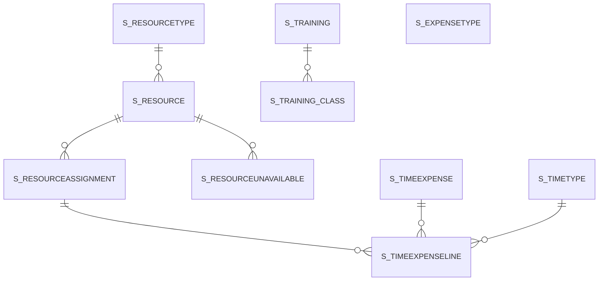

# Area S

10 table(s), 10 in scope.

| table | class | scope | rows | description |
|---|---|---|---|---|
| [S_EXPENSETYPE](../../data-model/s/s_expensetype.md) | business | in | 1 |  |
| [S_RESOURCE](../../data-model/s/s_resource.md) | business | in | 11 |  |
| [S_RESOURCEASSIGNMENT](../../data-model/s/s_resourceassignment.md) | business | in | 2 |  |
| [S_RESOURCETYPE](../../data-model/s/s_resourcetype.md) | business | in | 3 |  |
| [S_RESOURCEUNAVAILABLE](../../data-model/s/s_resourceunavailable.md) | business | in | 2 |  |
| [S_TIMEEXPENSE](../../data-model/s/s_timeexpense.md) | business | in | 1 |  |
| [S_TIMEEXPENSELINE](../../data-model/s/s_timeexpenseline.md) | business | in | 4 |  |
| [S_TIMETYPE](../../data-model/s/s_timetype.md) | business | in | 0 |  |
| [S_TRAINING](../../data-model/s/s_training.md) | business | in | 1 |  |
| [S_TRAINING_CLASS](../../data-model/s/s_training_class.md) | business | in | 0 |  |
