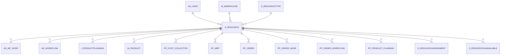

# S_RESOURCE

Area [S](../../data-model/s/index.md) · class **business** (proposed) · read from database `idempiere-db` (owner `ADEMPIERE`) · 11 row(s) when profiled

Application model: `org.compiere.model.X_S_Resource`, access level 3 - Client - Org.

## Columns

| column | type | key | not null | business name | references (code) | nulls | distinct |
|---|---|---|---|---|---|---|---|
| `S_RESOURCE_ID` | NUMBER(10,0) | PK | yes | Resource |  | 0 | 11 |
| `AD_CLIENT_ID` | NUMBER(10,0) |  | yes | Tenant |  | 0 | 1 |
| `AD_ORG_ID` | NUMBER(10,0) |  | yes | Organization |  | 0 | 1 |
| `ISACTIVE` | CHAR(1) |  | yes | Active |  | 0 | 1 |
| `CREATED` | DATE |  | yes | Created |  | 0 | 11 |
| `CREATEDBY` | NUMBER(10,0) |  | yes | Created By |  | 0 | 1 |
| `UPDATED` | DATE |  | yes | Updated |  | 0 | 11 |
| `UPDATEDBY` | NUMBER(10,0) |  | yes | Updated By |  | 0 | 2 |
| `VALUE` | VARCHAR2(40 CHAR) |  | yes | Search Key |  | 0 | 11 |
| `NAME` | VARCHAR2(60 CHAR) |  | yes | Name |  | 0 | 11 |
| `DESCRIPTION` | VARCHAR2(255 CHAR) |  |  | Description |  | 11 | 0 |
| `S_RESOURCETYPE_ID` | NUMBER(10,0) |  | yes | Resource Type | [S_RESOURCETYPE](../../data-model/s/s_resourcetype.md) | 0 | 3 |
| `M_WAREHOUSE_ID` | NUMBER(10,0) |  | yes | Warehouse | [M_WAREHOUSE](../../data-model/m/m_warehouse.md) | 0 | 3 |
| `ISAVAILABLE` | CHAR(1) |  | yes | Available |  | 0 | 1 |
| `AD_USER_ID` | NUMBER(10,0) |  |  | User/Contact | [AD_USER](../../data-model/ad/ad_user.md) | 11 | 0 |
| `CHARGEABLEQTY` | NUMBER |  |  | Chargeable Quantity |  | 0 | 1 |
| `PERCENTUTILIZATION` | NUMBER |  | yes | % Utilization |  | 0 | 1 |
| `DAILYCAPACITY` | NUMBER |  |  | Daily Capacity |  | 1 | 2 |
| `ISMANUFACTURINGRESOURCE` | CHAR(1) |  |  | Manufacturing Resource |  | 0 | 2 |
| `WAITINGTIME` | NUMBER |  |  | Waiting Time |  | 1 | 1 |
| `MANUFACTURINGRESOURCETYPE` | CHAR(2) |  |  | Manufacturing Resource Type |  | 1 | 3 |
| `QUEUINGTIME` | NUMBER |  |  | Queuing Time |  | 1 | 1 |
| `PLANNINGHORIZON` | NUMBER(10,0) |  |  | Planning Horizon |  | 0 | 2 |
| `S_RESOURCE_UU` | VARCHAR2(36 CHAR) |  |  | S_Resource_UU |  | 0 | 11 |

*references (code)* is the table the application model's code says a column points to; *Foreign keys* below are the constraints the database declares. Counts come from the profile; no value is ever shown.

## Check constraints

| name | expression |
|---|---|
| `CHK_COL_53272` | `PercentUtilization>=0` |
| `SYS_C0021692` | `IsAvailable in ('Y','N')` |
| `SYS_C0021694` | `IsActive in ('Y','N')` |
| `SYS_C0021696` | `IsManufacturingResource IN ('Y','N')` |

## Foreign keys

**References**

| table | columns | on delete |
|---|---|---|
| [AD_USER](../../data-model/ad/ad_user.md) | S_RESOURCE.AD_USER_ID → AD_USER.AD_USER_ID | NO ACTION |
| [M_WAREHOUSE](../../data-model/m/m_warehouse.md) | S_RESOURCE.M_WAREHOUSE_ID → M_WAREHOUSE.M_WAREHOUSE_ID | NO ACTION |
| [S_RESOURCETYPE](../../data-model/s/s_resourcetype.md) | S_RESOURCE.S_RESOURCETYPE_ID → S_RESOURCETYPE.S_RESOURCETYPE_ID | CASCADE |

**Referenced by**

| table | columns | on delete |
|---|---|---|
| [AD_WF_NODE](../../data-model/ad/ad_wf_node.md) | AD_WF_NODE.S_RESOURCE_ID → S_RESOURCE.S_RESOURCE_ID | NO ACTION |
| [AD_WORKFLOW](../../data-model/ad/ad_workflow.md) | AD_WORKFLOW.S_RESOURCE_ID → S_RESOURCE.S_RESOURCE_ID | NO ACTION |
| `I_PRODUCTPLANNING` | I_PRODUCTPLANNING.S_RESOURCE_ID → S_RESOURCE.S_RESOURCE_ID | NO ACTION |
| [M_PRODUCT](../../data-model/m/m_product.md) | M_PRODUCT.S_RESOURCE_ID → S_RESOURCE.S_RESOURCE_ID | NO ACTION |
| [PP_COST_COLLECTOR](../../data-model/pp/pp_cost_collector.md) | PP_COST_COLLECTOR.S_RESOURCE_ID → S_RESOURCE.S_RESOURCE_ID | NO ACTION |
| [PP_MRP](../../data-model/pp/pp_mrp.md) | PP_MRP.S_RESOURCE_ID → S_RESOURCE.S_RESOURCE_ID | NO ACTION |
| [PP_ORDER](../../data-model/pp/pp_order.md) | PP_ORDER.S_RESOURCE_ID → S_RESOURCE.S_RESOURCE_ID | NO ACTION |
| [PP_ORDER_NODE](../../data-model/pp/pp_order_node.md) | PP_ORDER_NODE.S_RESOURCE_ID → S_RESOURCE.S_RESOURCE_ID | NO ACTION |
| [PP_ORDER_WORKFLOW](../../data-model/pp/pp_order_workflow.md) | PP_ORDER_WORKFLOW.S_RESOURCE_ID → S_RESOURCE.S_RESOURCE_ID | NO ACTION |
| [PP_PRODUCT_PLANNING](../../data-model/pp/pp_product_planning.md) | PP_PRODUCT_PLANNING.S_RESOURCE_ID → S_RESOURCE.S_RESOURCE_ID | NO ACTION |
| [S_RESOURCEASSIGNMENT](../../data-model/s/s_resourceassignment.md) | S_RESOURCEASSIGNMENT.S_RESOURCE_ID → S_RESOURCE.S_RESOURCE_ID | NO ACTION |
| [S_RESOURCEUNAVAILABLE](../../data-model/s/s_resourceunavailable.md) | S_RESOURCEUNAVAILABLE.S_RESOURCE_ID → S_RESOURCE.S_RESOURCE_ID | CASCADE |

## Write behaviour

- updates: **po_only**
- deletes: **deleted_by_users, deleted_by_cascade**
- change log: **recorded**
- evidence: 2 citation(s)

## Schema history

24 change(s); the latest:

| applied | release | operation | column | tickets |
|---|---|---|---|---|
| 2023-04-09T15:47 | iD11 | `add_constraint` |  | IDEMPIERE-5567 |
| 2023-04-09T15:47 | iD11 | `add_constraint` |  | IDEMPIERE-5567 |
| 2021-12-05T16:45 | i8.2z | `add_constraint` |  | IDEMPIERE-5075 |
| 2021-12-05T16:45 | i8.2z | `add_constraint` |  | IDEMPIERE-5075 |
| 2021-12-05T16:45 | i8.2z | `add_constraint` |  | IDEMPIERE-5075 |
| 2021-12-05T16:45 | i8.2z | `drop_constraint` |  | IDEMPIERE-5075 |
| 2021-12-05T16:45 | i8.2z | `drop_constraint` |  | IDEMPIERE-5075 |
| 2021-12-05T16:45 | i8.2z | `drop_constraint` |  | IDEMPIERE-5075 |
| 2020-08-04T01:00 | i7.1z | `modify_column` | NAME | IDEMPIERE-3862 |
| 2020-08-04T01:00 | i7.1z | `add_column` | tmp_col_3_tmp | IDEMPIERE-3862 |
| 2020-08-04T01:00 | i7.1z | `modify_column` | NAME | IDEMPIERE-3862 |
| 2020-08-04T01:00 | i7.1z | `modify_column` | DESCRIPTION | IDEMPIERE-3862 |
| 2020-08-04T01:00 | i7.1z | `modify_column` | NAME | IDEMPIERE-3862 |
| 2020-08-04T01:00 | i7.1z | `modify_column` | VALUE | IDEMPIERE-3862 |
| 2020-08-04T01:00 | i7.1z | `modify_column` | VALUE | IDEMPIERE-3862 |

## Notes

<!-- ekos:manual id="table.s_resource.notes" -->
_Business notes about this table._
<!-- /ekos:manual -->
