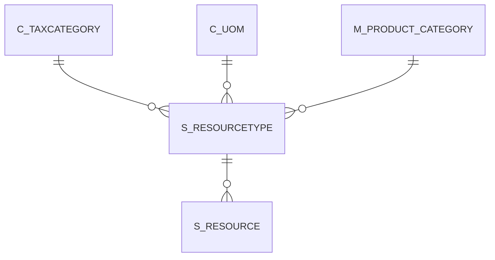

# S_RESOURCETYPE

Area [S](../../data-model/s/index.md) · class **business** (proposed) · read from database `idempiere-db` (owner `ADEMPIERE`) · 3 row(s) when profiled

Application model: `org.compiere.model.X_S_ResourceType`, access level 3 - Client - Org.

## Columns

| column | type | key | not null | business name | references (code) | nulls | distinct |
|---|---|---|---|---|---|---|---|
| `S_RESOURCETYPE_ID` | NUMBER(10,0) | PK | yes | Resource Type |  | 0 | 3 |
| `AD_CLIENT_ID` | NUMBER(10,0) |  | yes | Tenant |  | 0 | 1 |
| `AD_ORG_ID` | NUMBER(10,0) |  | yes | Organization |  | 0 | 2 |
| `ISACTIVE` | CHAR(1) |  | yes | Active |  | 0 | 1 |
| `CREATED` | DATE |  | yes | Created |  | 0 | 3 |
| `CREATEDBY` | NUMBER(10,0) |  | yes | Created By |  | 0 | 1 |
| `UPDATED` | DATE |  | yes | Updated |  | 0 | 3 |
| `UPDATEDBY` | NUMBER(10,0) |  | yes | Updated By |  | 0 | 2 |
| `VALUE` | VARCHAR2(40 CHAR) |  | yes | Search Key |  | 0 | 3 |
| `NAME` | VARCHAR2(60 CHAR) |  | yes | Name |  | 0 | 3 |
| `DESCRIPTION` | VARCHAR2(255 CHAR) |  |  | Description |  | 3 | 0 |
| `ISSINGLEASSIGNMENT` | CHAR(1) |  | yes | Single Assignment only |  | 0 | 1 |
| `C_UOM_ID` | NUMBER(10,0) |  | yes | UOM | [C_UOM](../../data-model/c/c_uom.md) | 0 | 1 |
| `ALLOWUOMFRACTIONS` | CHAR(1) |  | yes | Allow UoM Fractions |  | 0 | 1 |
| `TIMESLOTSTART` | DATE |  |  | Slot Start |  | 2 | 1 |
| `TIMESLOTEND` | DATE |  |  | Slot End |  | 2 | 1 |
| `ISTIMESLOT` | CHAR(1) |  | yes | Time Slot |  | 0 | 2 |
| `ISDATESLOT` | CHAR(1) |  | yes | Day Slot |  | 0 | 1 |
| `ONSUNDAY` | CHAR(1) |  | yes | Sunday |  | 0 | 2 |
| `ONMONDAY` | CHAR(1) |  | yes | Monday |  | 0 | 1 |
| `ONTUESDAY` | CHAR(1) |  | yes | Tuesday |  | 0 | 1 |
| `ONWEDNESDAY` | CHAR(1) |  | yes | Wednesday |  | 0 | 1 |
| `ONTHURSDAY` | CHAR(1) |  | yes | Thursday |  | 0 | 1 |
| `ONFRIDAY` | CHAR(1) |  | yes | Friday |  | 0 | 1 |
| `ONSATURDAY` | CHAR(1) |  | yes | Saturday |  | 0 | 2 |
| `M_PRODUCT_CATEGORY_ID` | NUMBER(10,0) |  | yes | Product Category | [M_PRODUCT_CATEGORY](../../data-model/m/m_product_category.md) | 0 | 2 |
| `C_TAXCATEGORY_ID` | NUMBER(10,0) |  | yes | Tax Category | [C_TAXCATEGORY](../../data-model/c/c_taxcategory.md) | 0 | 1 |
| `CHARGEABLEQTY` | NUMBER |  |  | Chargeable Quantity |  | 0 | 1 |
| `S_RESOURCETYPE_UU` | VARCHAR2(36 CHAR) |  |  | S_ResourceType_UU |  | 0 | 3 |

*references (code)* is the table the application model's code says a column points to; *Foreign keys* below are the constraints the database declares. Counts come from the profile; no value is ever shown.

## Check constraints

| name | expression |
|---|---|
| `SYS_C0020816` | `OnSunday in ('Y','N')` |
| `SYS_C0020817` | `OnThursday in ('Y','N')` |
| `SYS_C0020818` | `OnSaturday in ('Y','N')` |
| `SYS_C0020819` | `OnWednesday in ('Y','N')` |
| `SYS_C0020820` | `IsTimeSlot in ('Y','N')` |
| `SYS_C0020821` | `OnMonday in ('Y','N')` |
| `SYS_C0020822` | `AllowUOMFractions in ('Y','N')` |
| `SYS_C0020823` | `IsDateSlot in ('Y','N')` |
| `SYS_C0020824` | `IsActive in ('Y','N')` |
| `SYS_C0020825` | `IsSingleAssignment in ('Y','N')` |
| `SYS_C0020826` | `OnFriday in ('Y','N')` |
| `SYS_C0020828` | `OnTuesday in ('Y','N')` |

## Foreign keys

**References**

| table | columns | on delete |
|---|---|---|
| [C_TAXCATEGORY](../../data-model/c/c_taxcategory.md) | S_RESOURCETYPE.C_TAXCATEGORY_ID → C_TAXCATEGORY.C_TAXCATEGORY_ID | NO ACTION |
| [C_UOM](../../data-model/c/c_uom.md) | S_RESOURCETYPE.C_UOM_ID → C_UOM.C_UOM_ID | NO ACTION |
| [M_PRODUCT_CATEGORY](../../data-model/m/m_product_category.md) | S_RESOURCETYPE.M_PRODUCT_CATEGORY_ID → M_PRODUCT_CATEGORY.M_PRODUCT_CATEGORY_ID | NO ACTION |

**Referenced by**

| table | columns | on delete |
|---|---|---|
| [S_RESOURCE](../../data-model/s/s_resource.md) | S_RESOURCE.S_RESOURCETYPE_ID → S_RESOURCETYPE.S_RESOURCETYPE_ID | CASCADE |

## Write behaviour

- updates: **po_only**
- deletes: **deleted_by_users**
- change log: **recorded**
- evidence: 1 citation(s)

## Schema history

24 change(s); the latest:

| applied | release | operation | column | tickets |
|---|---|---|---|---|
| 2023-04-09T15:47 | iD11 | `add_constraint` |  | IDEMPIERE-5567 |
| 2023-04-09T15:47 | iD11 | `add_constraint` |  | IDEMPIERE-5567 |
| 2021-12-05T16:45 | i8.2z | `add_constraint` |  | IDEMPIERE-5075 |
| 2021-12-05T16:45 | i8.2z | `drop_constraint` |  | IDEMPIERE-5075 |
| 2021-12-05T16:45 | i8.2z | `drop_constraint` |  | IDEMPIERE-5075 |
| 2021-12-05T16:45 | i8.2z | `add_constraint` |  | IDEMPIERE-5075 |
| 2021-12-05T16:45 | i8.2z | `drop_constraint` |  | IDEMPIERE-5075 |
| 2021-12-05T16:45 | i8.2z | `add_constraint` |  | IDEMPIERE-5075 |
| 2020-08-04T01:00 | i7.1z | `add_column` | tmp_col_2_tmp | IDEMPIERE-3862 |
| 2020-08-04T01:00 | i7.1z | `modify_column` | NAME | IDEMPIERE-3862 |
| 2020-08-04T01:00 | i7.1z | `drop_column` | tmp_col_1_tmp | IDEMPIERE-3862 |
| 2020-08-04T01:00 | i7.1z | `modify_column` | NAME | IDEMPIERE-3862 |
| 2020-08-04T01:00 | i7.1z | `modify_column` | VALUE | IDEMPIERE-3862 |
| 2020-08-04T01:00 | i7.1z | `modify_column` | VALUE | IDEMPIERE-3862 |
| 2020-08-04T01:00 | i7.1z | `add_column` | tmp_col_3_tmp | IDEMPIERE-3862 |

## Notes

<!-- ekos:manual id="table.s_resourcetype.notes" -->
_Business notes about this table._
<!-- /ekos:manual -->
