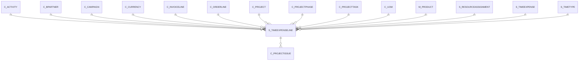

# S_TIMEEXPENSELINE

Area [S](../../data-model/s/index.md) · class **business** (proposed) · read from database `idempiere-db` (owner `ADEMPIERE`) · 4 row(s) when profiled

Application model: `org.compiere.model.X_S_TimeExpenseLine`, access level 1 - Org.

## Columns

| column | type | key | not null | business name | references (code) | nulls | distinct |
|---|---|---|---|---|---|---|---|
| `S_TIMEEXPENSELINE_ID` | NUMBER(10,0) | PK | yes | Expense Line |  | 0 | 4 |
| `AD_CLIENT_ID` | NUMBER(10,0) |  | yes | Tenant |  | 0 | 1 |
| `AD_ORG_ID` | NUMBER(10,0) |  | yes | Organization |  | 0 | 1 |
| `ISACTIVE` | CHAR(1) |  | yes | Active |  | 0 | 1 |
| `CREATED` | DATE |  | yes | Created |  | 0 | 4 |
| `CREATEDBY` | NUMBER(10,0) |  | yes | Created By |  | 0 | 1 |
| `UPDATED` | DATE |  | yes | Updated |  | 0 | 4 |
| `UPDATEDBY` | NUMBER(10,0) |  | yes | Updated By |  | 0 | 2 |
| `S_TIMEEXPENSE_ID` | NUMBER(10,0) |  | yes | Expense Report | [S_TIMEEXPENSE](../../data-model/s/s_timeexpense.md) | 0 | 1 |
| `LINE` | NUMBER(10,0) |  | yes | Line No |  | 0 | 4 |
| `ISTIMEREPORT` | CHAR(1) |  | yes | Time Report |  | 0 | 2 |
| `DATEEXPENSE` | DATE |  |  | Expense Date |  | 0 | 2 |
| `M_PRODUCT_ID` | NUMBER(10,0) |  |  | Product | [M_PRODUCT](../../data-model/m/m_product.md) | 1 | 2 |
| `QTY` | NUMBER |  |  | Quantity |  | 0 | 3 |
| `EXPENSEAMT` | NUMBER |  |  | Expense Amount |  | 0 | 2 |
| `C_CURRENCY_ID` | NUMBER(10,0) |  |  | Currency | [C_CURRENCY](../../data-model/c/c_currency.md) | 0 | 1 |
| `CONVERTEDAMT` | NUMBER |  |  | Converted Amount |  | 0 | 2 |
| `S_RESOURCEASSIGNMENT_ID` | NUMBER(10,0) |  |  | Resource Assignment |  | 2 | 2 |
| `DESCRIPTION` | VARCHAR2(255 CHAR) |  |  | Description |  | 1 | 3 |
| `NOTE` | VARCHAR2(255 CHAR) |  |  | Note |  | 4 | 0 |
| `ISINVOICED` | CHAR(1) |  | yes | Invoiced |  | 0 | 2 |
| `C_BPARTNER_ID` | NUMBER(10,0) |  |  | Business Partner | [C_BPARTNER](../../data-model/c/c_bpartner.md) | 0 | 1 |
| `C_PROJECT_ID` | NUMBER(10,0) |  |  | Project | [C_PROJECT](../../data-model/c/c_project.md) | 0 | 1 |
| `C_ACTIVITY_ID` | NUMBER(10,0) |  |  | Activity | [C_ACTIVITY](../../data-model/c/c_activity.md) | 4 | 0 |
| `C_CAMPAIGN_ID` | NUMBER(10,0) |  |  | Campaign | [C_CAMPAIGN](../../data-model/c/c_campaign.md) | 4 | 0 |
| `C_INVOICELINE_ID` | NUMBER(10,0) |  |  | Invoice Line | [C_INVOICELINE](../../data-model/c/c_invoiceline.md) | 4 | 0 |
| `INVOICEPRICE` | NUMBER |  |  | Invoice Price |  | 0 | 2 |
| `C_UOM_ID` | NUMBER(10,0) |  |  | UOM | [C_UOM](../../data-model/c/c_uom.md) | 3 | 1 |
| `C_ORDERLINE_ID` | NUMBER(10,0) |  |  | Sales Order Line | [C_ORDERLINE](../../data-model/c/c_orderline.md) | 4 | 0 |
| `C_PROJECTPHASE_ID` | NUMBER(10,0) |  |  | Project Phase | [C_PROJECTPHASE](../../data-model/c/c_projectphase.md) | 4 | 0 |
| `C_PROJECTTASK_ID` | NUMBER(10,0) |  |  | Project Task | [C_PROJECTTASK](../../data-model/c/c_projecttask.md) | 4 | 0 |
| `S_TIMETYPE_ID` | NUMBER(10,0) |  |  | Time Type | [S_TIMETYPE](../../data-model/s/s_timetype.md) | 4 | 0 |
| `PROCESSED` | CHAR(1) |  | yes | Processed |  | 0 | 1 |
| `QTYINVOICED` | NUMBER |  |  | Quantity Invoiced |  | 4 | 0 |
| `QTYREIMBURSED` | NUMBER |  |  | Quantity Reimbursed |  | 4 | 0 |
| `PRICEINVOICED` | NUMBER |  |  | Price Invoiced |  | 4 | 0 |
| `PRICEREIMBURSED` | NUMBER |  |  | Price Reimbursed |  | 4 | 0 |
| `S_TIMEEXPENSELINE_UU` | VARCHAR2(36 CHAR) |  |  | S_TimeExpenseLine_UU |  | 0 | 4 |
| `LINENETAMT` | NUMBER |  |  | Line Amount |  | 3 | 1 |

*references (code)* is the table the application model's code says a column points to; *Foreign keys* below are the constraints the database declares. Counts come from the profile; no value is ever shown.

## Check constraints

| name | expression |
|---|---|
| `SYS_C0019789` | `IsTimeReport in ('Y','N')` |
| `SYS_C0019792` | `IsActive in ('Y','N')` |
| `SYS_C0019793` | `IsInvoiced in ('Y','N')` |

## Foreign keys

**References**

| table | columns | on delete |
|---|---|---|
| [C_ACTIVITY](../../data-model/c/c_activity.md) | S_TIMEEXPENSELINE.C_ACTIVITY_ID → C_ACTIVITY.C_ACTIVITY_ID | NO ACTION |
| [C_BPARTNER](../../data-model/c/c_bpartner.md) | S_TIMEEXPENSELINE.C_BPARTNER_ID → C_BPARTNER.C_BPARTNER_ID | NO ACTION |
| [C_CAMPAIGN](../../data-model/c/c_campaign.md) | S_TIMEEXPENSELINE.C_CAMPAIGN_ID → C_CAMPAIGN.C_CAMPAIGN_ID | NO ACTION |
| [C_CURRENCY](../../data-model/c/c_currency.md) | S_TIMEEXPENSELINE.C_CURRENCY_ID → C_CURRENCY.C_CURRENCY_ID | NO ACTION |
| [C_INVOICELINE](../../data-model/c/c_invoiceline.md) | S_TIMEEXPENSELINE.C_INVOICELINE_ID → C_INVOICELINE.C_INVOICELINE_ID | NO ACTION |
| [C_ORDERLINE](../../data-model/c/c_orderline.md) | S_TIMEEXPENSELINE.C_ORDERLINE_ID → C_ORDERLINE.C_ORDERLINE_ID | NO ACTION |
| [C_PROJECT](../../data-model/c/c_project.md) | S_TIMEEXPENSELINE.C_PROJECT_ID → C_PROJECT.C_PROJECT_ID | NO ACTION |
| [C_PROJECTPHASE](../../data-model/c/c_projectphase.md) | S_TIMEEXPENSELINE.C_PROJECTPHASE_ID → C_PROJECTPHASE.C_PROJECTPHASE_ID | NO ACTION |
| [C_PROJECTTASK](../../data-model/c/c_projecttask.md) | S_TIMEEXPENSELINE.C_PROJECTTASK_ID → C_PROJECTTASK.C_PROJECTTASK_ID | NO ACTION |
| [C_UOM](../../data-model/c/c_uom.md) | S_TIMEEXPENSELINE.C_UOM_ID → C_UOM.C_UOM_ID | NO ACTION |
| [M_PRODUCT](../../data-model/m/m_product.md) | S_TIMEEXPENSELINE.M_PRODUCT_ID → M_PRODUCT.M_PRODUCT_ID | NO ACTION |
| [S_RESOURCEASSIGNMENT](../../data-model/s/s_resourceassignment.md) | S_TIMEEXPENSELINE.S_RESOURCEASSIGNMENT_ID → S_RESOURCEASSIGNMENT.S_RESOURCEASSIGNMENT_ID | NO ACTION |
| [S_TIMEEXPENSE](../../data-model/s/s_timeexpense.md) | S_TIMEEXPENSELINE.S_TIMEEXPENSE_ID → S_TIMEEXPENSE.S_TIMEEXPENSE_ID | CASCADE |
| [S_TIMETYPE](../../data-model/s/s_timetype.md) | S_TIMEEXPENSELINE.S_TIMETYPE_ID → S_TIMETYPE.S_TIMETYPE_ID | NO ACTION |

**Referenced by**

| table | columns | on delete |
|---|---|---|
| [C_PROJECTISSUE](../../data-model/c/c_projectissue.md) | C_PROJECTISSUE.S_TIMEEXPENSELINE_ID → S_TIMEEXPENSELINE.S_TIMEEXPENSELINE_ID | NO ACTION |

## Write behaviour

- updates: **raw_sql_skips_updated**
- deletes: **deleted_by_users, deleted_by_cascade**
- change log: **recorded**
- evidence: 3 citation(s)

## Schema history

45 change(s); the latest:

| applied | release | operation | column | tickets |
|---|---|---|---|---|
| 2023-12-04T16:13 | iD10 | `drop_column` | PriceEntered | IDEMPIERE-5602 |
| 2023-12-04T16:13 | iD10 | `add_column` | LineNetAmt | IDEMPIERE-5602 |
| 2023-12-04T16:13 | iD10 | `drop_column` | PriceEntered | IDEMPIERE-5602 |
| 2023-12-04T16:13 | iD10 | `add_column` | LineNetAmt | IDEMPIERE-5602 |
| 2023-04-09T15:47 | iD11 | `add_constraint` |  | IDEMPIERE-5567 |
| 2023-04-09T15:47 | iD11 | `add_constraint` |  | IDEMPIERE-5567 |
| 2023-03-07T15:43 | iD10 | `add_column` | PriceEntered | IDEMPIERE-5602 |
| 2023-03-07T15:43 | iD10 | `add_column` | PriceEntered | IDEMPIERE-5602 |
| 2021-12-05T16:45 | i8.2z | `drop_constraint` |  | IDEMPIERE-5075 |
| 2021-12-05T16:45 | i8.2z | `add_constraint` |  | IDEMPIERE-5075 |
| 2021-12-05T16:45 | i8.2z | `drop_constraint` |  | IDEMPIERE-5075 |
| 2021-12-05T16:45 | i8.2z | `drop_constraint` |  | IDEMPIERE-5075 |
| 2021-12-05T16:45 | i8.2z | `drop_constraint` |  | IDEMPIERE-5075 |
| 2021-12-05T16:45 | i8.2z | `add_constraint` |  | IDEMPIERE-5075 |
| 2021-12-05T16:45 | i8.2z | `add_constraint` |  | IDEMPIERE-5075 |

## Open conflicts

| type | attribute | explanation |
|---|---|---|
| `mandatory_but_nullable` | `columns.DateExpense.nullable` | unexplained |

## Notes

<!-- ekos:manual id="table.s_timeexpenseline.notes" -->
_Business notes about this table._
<!-- /ekos:manual -->
