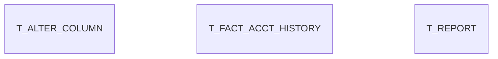

# Area T

23 table(s), 3 in scope.

| table | class | scope | rows | description |
|---|---|---|---|---|
| `T_1099EXTRACT` | transient | out | 0 |  |
| `T_AGING` | transient | out | 0 |  |
| [T_ALTER_COLUMN](../../data-model/t/t_alter_column.md) | unclassified | in |  |  |
| `T_BANKREGISTER` | transient | out | 0 |  |
| `T_BOMLINE` | transient | out | 0 |  |
| `T_BOM_INDENTED` | transient | out | 0 |  |
| `T_CASHFLOW` | transient | out | 0 |  |
| `T_DISTRIBUTIONRUNDETAIL` | transient | out | 0 |  |
| [T_FACT_ACCT_HISTORY](../../data-model/t/t_fact_acct_history.md) | unclassified | in |  |  |
| `T_INVENTORYVALUE` | transient | out | 0 |  |
| `T_INVOICEGL` | transient | out | 0 | The real data displayed in T_InvoiceGL_v |
| `T_MOVECLIENT` | transient | out | 0 |  |
| `T_MRP_CRP` | transient | out | 0 |  |
| `T_RECONCILIATION` | transient | out | 0 |  |
| `T_REPLENISH` | transient | out | 0 |  |
| [T_REPORT](../../data-model/t/t_report.md) | transient | in | 0 | Temporary Store for Report Data |
| `T_REPORTSTATEMENT` | transient | out | 0 |  |
| `T_SELECTION` | transient | out | 0 |  |
| `T_SELECTION2` | transient | out | 0 |  |
| `T_SELECTION_INFOWINDOW` | transient | out | 0 |  |
| `T_SPOOL` | transient | out | 0 |  |
| `T_TRANSACTION` | transient | out | 0 |  |
| `T_TRIALBALANCE` | transient | out | 0 |  |
