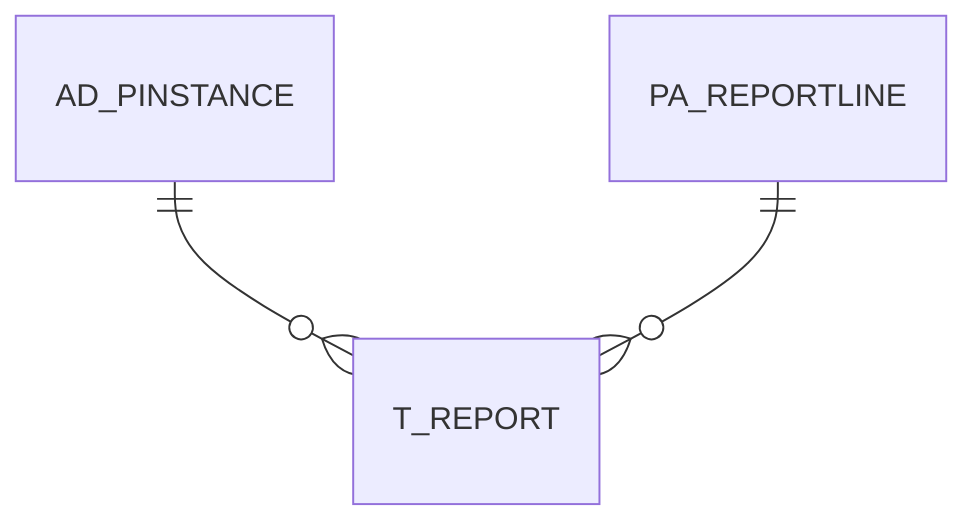

# T_REPORT

Temporary Store for Report Data

Area [T](../../data-model/t/index.md) · class **transient** (reviewed) · read from database `idempiere-db` (owner `ADEMPIERE`) · 0 row(s) when profiled

Application model: `org.compiere.model.X_T_Report`, access level 4 - System.

## Columns

| column | type | key | not null | business name | references (code) | nulls | distinct |
|---|---|---|---|---|---|---|---|
| `AD_PINSTANCE_ID` | NUMBER(10,0) | PK | yes | Process Instance | [AD_PINSTANCE](../../data-model/ad/ad_pinstance.md) | 0 | 0 |
| `PA_REPORTLINE_ID` | NUMBER(10,0) | PK | yes | Report Line | [PA_REPORTLINE](../../data-model/pa/pa_reportline.md) | 0 | 0 |
| `RECORD_ID` | NUMBER(10,0) | PK | yes | Record ID |  | 0 | 0 |
| `FACT_ACCT_ID` | NUMBER(10,0) | PK | yes | Accounting Fact |  | 0 | 0 |
| `SEQNO` | NUMBER |  |  | Sequence |  | 0 | 0 |
| `LEVELNO` | NUMBER(10,0) |  |  | Level no |  | 0 | 0 |
| `NAME` | VARCHAR2(60 CHAR) |  |  | Name |  | 0 | 0 |
| `DESCRIPTION` | VARCHAR2(255 CHAR) |  |  | Description |  | 0 | 0 |
| `COL_0` | NUMBER |  |  | Col_0 |  | 0 | 0 |
| `COL_2` | NUMBER |  |  | Col_2 |  | 0 | 0 |
| `COL_1` | NUMBER |  |  | Col_1 |  | 0 | 0 |
| `COL_3` | NUMBER |  |  | Col_3 |  | 0 | 0 |
| `COL_4` | NUMBER |  |  | Col_4 |  | 0 | 0 |
| `COL_5` | NUMBER |  |  | Col_5 |  | 0 | 0 |
| `COL_6` | NUMBER |  |  | Col_6 |  | 0 | 0 |
| `COL_7` | NUMBER |  |  | Col_7 |  | 0 | 0 |
| `COL_8` | NUMBER |  |  | Col_8 |  | 0 | 0 |
| `COL_9` | NUMBER |  |  | Col_9 |  | 0 | 0 |
| `COL_10` | NUMBER |  |  | Col_10 |  | 0 | 0 |
| `COL_11` | NUMBER |  |  | Col_11 |  | 0 | 0 |
| `COL_12` | NUMBER |  |  | Col_12 |  | 0 | 0 |
| `COL_13` | NUMBER |  |  | Col_13 |  | 0 | 0 |
| `COL_14` | NUMBER |  |  | Col_14 |  | 0 | 0 |
| `COL_15` | NUMBER |  |  | Col_15 |  | 0 | 0 |
| `COL_16` | NUMBER |  |  | Col_16 |  | 0 | 0 |
| `COL_17` | NUMBER |  |  | Col_17 |  | 0 | 0 |
| `COL_18` | NUMBER |  |  | Col_18 |  | 0 | 0 |
| `COL_19` | NUMBER |  |  | Col_19 |  | 0 | 0 |
| `COL_20` | NUMBER |  |  | Col_20 |  | 0 | 0 |
| `T_REPORT_UU` | VARCHAR2(36 CHAR) |  |  | T_Report_UU |  | 0 | 0 |
| `COL_21` | NUMBER |  |  | Col_21 |  | 0 | 0 |
| `COL_22` | NUMBER |  |  | Col_22 |  | 0 | 0 |
| `COL_23` | NUMBER |  |  | Col_23 |  | 0 | 0 |
| `COL_24` | NUMBER |  |  | Col_24 |  | 0 | 0 |
| `COL_25` | NUMBER |  |  | Col_25 |  | 0 | 0 |
| `COL_26` | NUMBER |  |  | Col_26 |  | 0 | 0 |
| `COL_27` | NUMBER |  |  | Col_27 |  | 0 | 0 |
| `COL_28` | NUMBER |  |  | Col_28 |  | 0 | 0 |
| `COL_29` | NUMBER |  |  | Col_29 |  | 0 | 0 |
| `COL_30` | NUMBER |  |  | Col_30 |  | 0 | 0 |

*references (code)* is the table the application model's code says a column points to; *Foreign keys* below are the constraints the database declares. Counts come from the profile; no value is ever shown.

## Foreign keys

**References**

| table | columns | on delete |
|---|---|---|
| [AD_PINSTANCE](../../data-model/ad/ad_pinstance.md) | T_REPORT.AD_PINSTANCE_ID → AD_PINSTANCE.AD_PINSTANCE_ID | CASCADE |
| [PA_REPORTLINE](../../data-model/pa/pa_reportline.md) | T_REPORT.PA_REPORTLINE_ID → PA_REPORTLINE.PA_REPORTLINE_ID | CASCADE |

**Referenced by**

_None._

## Write behaviour

- updates: **no_updated_column**
- deletes: **deleted_by_app, deleted_by_users, deleted_by_cascade**
- change log: **not_recorded**
- evidence: 11 citation(s)

## Schema history

35 change(s); the latest:

| applied | release | operation | column | tickets |
|---|---|---|---|---|
| 2023-04-09T15:47 | iD11 | `add_constraint` |  | IDEMPIERE-5567 |
| 2023-04-09T15:47 | iD11 | `add_constraint` |  | IDEMPIERE-5567 |
| 2021-12-05T16:45 | i8.2z | `drop_constraint` |  | IDEMPIERE-5075 |
| 2021-12-05T16:45 | i8.2z | `add_constraint` |  | IDEMPIERE-5075 |
| 2021-12-05T16:45 | i8.2z | `add_constraint` |  | IDEMPIERE-5075 |
| 2021-12-05T16:45 | i8.2z | `drop_constraint` |  | IDEMPIERE-5075 |
| 2020-08-04T01:00 | i7.1z | `add_column` | tmp_col_3_tmp | IDEMPIERE-3862 |
| 2020-08-04T01:00 | i7.1z | `add_column` | tmp_col_1_tmp | IDEMPIERE-3862 |
| 2020-08-04T01:00 | i7.1z | `drop_column` | tmp_col_2_tmp | IDEMPIERE-3862 |
| 2020-08-04T01:00 | i7.1z | `add_column` | tmp_col_2_tmp | IDEMPIERE-3862 |
| 2020-08-04T01:00 | i7.1z | `modify_column` | DESCRIPTION | IDEMPIERE-3862 |
| 2020-08-04T01:00 | i7.1z | `modify_column` | T_REPORT_UU | IDEMPIERE-3862 |
| 2020-08-04T01:00 | i7.1z | `modify_column` | NAME | IDEMPIERE-3862 |
| 2020-08-04T01:00 | i7.1z | `drop_column` | tmp_col_3_tmp | IDEMPIERE-3862 |
| 2020-08-04T01:00 | i7.1z | `drop_column` | tmp_col_1_tmp | IDEMPIERE-3862 |

## Notes

<!-- ekos:manual id="table.t_report.notes" -->
_Business notes about this table._
<!-- /ekos:manual -->
