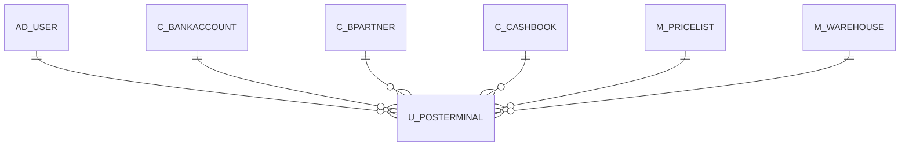

# U_POSTERMINAL

Area [U](../../data-model/u/index.md) · class **business** (proposed) · read from database `idempiere-db` (owner `ADEMPIERE`) · 1 row(s) when profiled

Application model: `org.compiere.model.X_U_POSTerminal`, access level 1 - Org.

## Columns

| column | type | key | not null | business name | references (code) | nulls | distinct |
|---|---|---|---|---|---|---|---|
| `AD_CLIENT_ID` | NUMBER(10,0) |  | yes | Tenant |  | 0 | 1 |
| `AD_ORG_ID` | NUMBER(10,0) |  | yes | Organization |  | 0 | 1 |
| `AUTOLOCK` | CHAR(1) |  | yes | Auto Lock |  | 0 | 1 |
| `CARD_BANKACCOUNT_ID` | NUMBER(10,0) |  |  | Card Bank Account | [C_BANKACCOUNT](../../data-model/c/c_bankaccount.md) | 0 | 1 |
| `CARDTRANSFERBANKACCOUNT_ID` | NUMBER(10,0) |  |  | Transfer Card trx to | [C_BANKACCOUNT](../../data-model/c/c_bankaccount.md) | 0 | 1 |
| `CARDTRANSFERCASHBOOK_ID` | NUMBER(10,0) |  |  | Transfer Card trx to | [C_CASHBOOK](../../data-model/c/c_cashbook.md) | 0 | 1 |
| `CARDTRANSFERTYPE` | CHAR(1) |  |  | Card Transfer Type |  | 0 | 1 |
| `CASHBOOKTRANSFERTYPE` | CHAR(1) |  | yes | Cash Book Transfer Type |  | 0 | 1 |
| `CASHTRANSFERBANKACCOUNT_ID` | NUMBER(10,0) |  |  | Transfer Cash trx to | [C_BANKACCOUNT](../../data-model/c/c_bankaccount.md) | 0 | 1 |
| `CASHTRANSFERCASHBOOK_ID` | NUMBER(10,0) |  |  | Transfer Cash trx to | [C_CASHBOOK](../../data-model/c/c_cashbook.md) | 0 | 1 |
| `C_CASHBOOK_ID` | NUMBER(10,0) |  | yes | Cash Book | [C_CASHBOOK](../../data-model/c/c_cashbook.md) | 0 | 1 |
| `C_CASHBPARTNER_ID` | NUMBER(10,0) |  | yes | Cash BPartner | [C_BPARTNER](../../data-model/c/c_bpartner.md) | 0 | 1 |
| `CHECK_BANKACCOUNT_ID` | NUMBER(10,0) |  |  | Check Bank Account | [C_BANKACCOUNT](../../data-model/c/c_bankaccount.md) | 0 | 1 |
| `CHECKTRANSFERBANKACCOUNT_ID` | NUMBER(10,0) |  |  | Transfer Check trx to | [C_BANKACCOUNT](../../data-model/c/c_bankaccount.md) | 0 | 1 |
| `CHECKTRANSFERCASHBOOK_ID` | NUMBER(10,0) |  |  | Transfer Check trx to | [C_CASHBOOK](../../data-model/c/c_cashbook.md) | 0 | 1 |
| `CHECKTRANSFERTYPE` | CHAR(1) |  |  | Check Transfer Type |  | 0 | 1 |
| `CREATED` | DATE |  | yes | Created |  | 0 | 1 |
| `CREATEDBY` | NUMBER(10,0) |  | yes | Created By |  | 0 | 1 |
| `C_TEMPLATEBPARTNER_ID` | NUMBER(10,0) |  |  | Template BPartner | [C_BPARTNER](../../data-model/c/c_bpartner.md) | 0 | 1 |
| `DESCRIPTION` | VARCHAR2(255 CHAR) |  |  | Description |  | 0 | 1 |
| `HELP` | VARCHAR2(2000 CHAR) |  |  | Comment/Help |  | 1 | 0 |
| `ISACTIVE` | CHAR(1) |  |  | Active |  | 0 | 1 |
| `LASTLOCKTIME` | DATE |  |  | Last Lock Time |  | 1 | 0 |
| `LOCKED` | CHAR(1) |  |  | Locked |  | 0 | 1 |
| `LOCKTIME` | NUMBER(10,0) |  |  | Lock Time |  | 0 | 1 |
| `M_WAREHOUSE_ID` | NUMBER(10,0) |  |  | Warehouse | [M_WAREHOUSE](../../data-model/m/m_warehouse.md) | 0 | 1 |
| `NAME` | VARCHAR2(60 CHAR) |  |  | Name |  | 0 | 1 |
| `PO_PRICELIST_ID` | NUMBER(10,0) |  |  | Purchase Price List | [M_PRICELIST](../../data-model/m/m_pricelist.md) | 0 | 1 |
| `PRINTERNAME` | VARCHAR2(60 CHAR) |  |  | Printer Name |  | 1 | 0 |
| `SALESREP_ID` | NUMBER(10,0) |  |  | Sales Representative | [AD_USER](../../data-model/ad/ad_user.md) | 0 | 1 |
| `SO_PRICELIST_ID` | NUMBER(10,0) |  |  | Sales Price List | [M_PRICELIST](../../data-model/m/m_pricelist.md) | 0 | 1 |
| `UNLOCKINGTIME` | DATE |  |  | Unlocking Time |  | 1 | 0 |
| `UPDATED` | DATE |  | yes | Updated |  | 0 | 1 |
| `UPDATEDBY` | NUMBER(10,0) |  |  | Updated By |  | 0 | 1 |
| `U_POSTERMINAL_ID` | NUMBER(10,0) | PK | yes | POS Terminal |  | 0 | 1 |
| `VALUE` | VARCHAR2(40 CHAR) |  |  | Search Key |  | 0 | 1 |
| `U_POSTERMINAL_UU` | VARCHAR2(36 CHAR) |  |  | U_POSTerminal_UU |  | 0 | 1 |

*references (code)* is the table the application model's code says a column points to; *Foreign keys* below are the constraints the database declares. Counts come from the profile; no value is ever shown.

## Check constraints

| name | expression |
|---|---|
| `SYS_C0022681` | `IsActive IN ('Y','N')` |
| `SYS_C0022683` | `AutoLock IN ('Y','N')` |
| `SYS_C0022685` | `Locked IN ('Y','N')` |

## Foreign keys

**References**

| table | columns | on delete |
|---|---|---|
| [AD_USER](../../data-model/ad/ad_user.md) | U_POSTERMINAL.SALESREP_ID → AD_USER.AD_USER_ID | NO ACTION |
| [C_BANKACCOUNT](../../data-model/c/c_bankaccount.md) | U_POSTERMINAL.CARD_BANKACCOUNT_ID → C_BANKACCOUNT.C_BANKACCOUNT_ID | NO ACTION |
| [C_BPARTNER](../../data-model/c/c_bpartner.md) | U_POSTERMINAL.C_CASHBPARTNER_ID → C_BPARTNER.C_BPARTNER_ID | NO ACTION |
| [C_CASHBOOK](../../data-model/c/c_cashbook.md) | U_POSTERMINAL.CARDTRANSFERCASHBOOK_ID → C_CASHBOOK.C_CASHBOOK_ID | NO ACTION |
| [M_PRICELIST](../../data-model/m/m_pricelist.md) | U_POSTERMINAL.PO_PRICELIST_ID → M_PRICELIST.M_PRICELIST_ID | NO ACTION |
| [M_WAREHOUSE](../../data-model/m/m_warehouse.md) | U_POSTERMINAL.M_WAREHOUSE_ID → M_WAREHOUSE.M_WAREHOUSE_ID | NO ACTION |

**Referenced by**

_None._

## Write behaviour

- updates: **po_only**
- deletes: **deleted_by_users**
- change log: **recorded**
- evidence: 1 citation(s)

## Schema history

60 change(s); the latest:

| applied | release | operation | column | tickets |
|---|---|---|---|---|
| 2023-04-09T15:47 | iD11 | `add_constraint` |  | IDEMPIERE-5567 |
| 2023-04-09T15:47 | iD11 | `add_constraint` |  | IDEMPIERE-5567 |
| 2021-12-05T16:45 | i8.2z | `drop_constraint` |  | IDEMPIERE-5075 |
| 2021-12-05T16:45 | i8.2z | `add_constraint` |  | IDEMPIERE-5075 |
| 2021-12-05T16:45 | i8.2z | `drop_constraint` |  | IDEMPIERE-5075 |
| 2021-12-05T16:45 | i8.2z | `add_constraint` |  | IDEMPIERE-5075 |
| 2021-12-05T16:45 | i8.2z | `drop_constraint` |  | IDEMPIERE-5075 |
| 2021-12-05T16:45 | i8.2z | `add_constraint` |  | IDEMPIERE-5075 |
| 2021-12-05T16:45 | i8.2z | `drop_constraint` |  | IDEMPIERE-5075 |
| 2021-12-05T16:45 | i8.2z | `drop_constraint` |  | IDEMPIERE-5075 |
| 2021-12-05T16:45 | i8.2z | `drop_constraint` |  | IDEMPIERE-5075 |
| 2021-12-05T16:45 | i8.2z | `add_constraint` |  | IDEMPIERE-5075 |
| 2021-12-05T16:45 | i8.2z | `drop_constraint` |  | IDEMPIERE-5075 |
| 2021-12-05T16:45 | i8.2z | `add_constraint` |  | IDEMPIERE-5075 |
| 2021-12-05T16:45 | i8.2z | `add_constraint` |  | IDEMPIERE-5075 |

## Notes

<!-- ekos:manual id="table.u_posterminal.notes" -->
_Business notes about this table._
<!-- /ekos:manual -->
