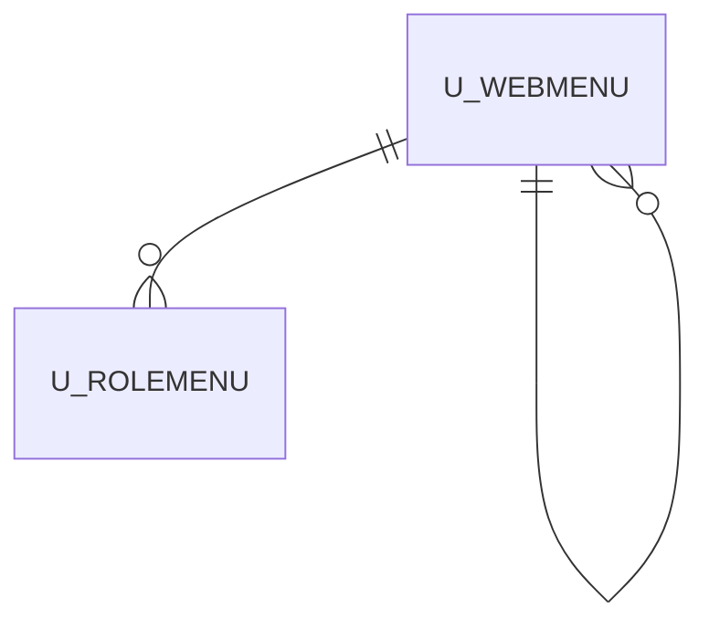

# U_WEBMENU

Area [U](../../data-model/u/index.md) · class **business** (proposed) · read from database `idempiere-db` (owner `ADEMPIERE`) · 143 row(s) when profiled

Application model: `org.compiere.model.X_U_WebMenu`, access level 4 - System.

## Columns

| column | type | key | not null | business name | references (code) | nulls | distinct |
|---|---|---|---|---|---|---|---|
| `U_WEBMENU_ID` | NUMBER(10,0) | PK | yes | Web Menu |  | 0 | 143 |
| `AD_CLIENT_ID` | NUMBER(10,0) |  | yes | Tenant |  | 0 | 1 |
| `AD_ORG_ID` | NUMBER(10,0) |  | yes | Organization |  | 0 | 1 |
| `ISACTIVE` | CHAR(1) |  | yes | Active |  | 0 | 1 |
| `CREATED` | DATE |  | yes | Created |  | 0 | 143 |
| `CREATEDBY` | NUMBER(10,0) |  | yes | Created By |  | 0 | 1 |
| `UPDATED` | DATE |  | yes | Updated |  | 0 | 143 |
| `UPDATEDBY` | NUMBER(10,0) |  | yes | Updated By |  | 0 | 1 |
| `NAME` | VARCHAR2(120 CHAR) |  | yes | Name |  | 0 | 143 |
| `MENULINK` | VARCHAR2(510 CHAR) |  | yes | Menu Link |  | 0 | 136 |
| `MODULE` | VARCHAR2(120 CHAR) |  | yes | Module |  | 0 | 1 |
| `PARENTMENU_ID` | NUMBER(10,0) |  |  | Parent Menu | [U_WEBMENU](../../data-model/u/u_webmenu.md) | 8 | 8 |
| `HASSUBMENU` | CHAR(1) |  | yes | Has SubMenu |  | 0 | 1 |
| `DESCRIPTION` | VARCHAR2(200 CHAR) |  |  | Description |  | 143 | 0 |
| `IMAGELINK` | VARCHAR2(510 CHAR) |  |  | Image Link |  | 135 | 3 |
| `POSITION` | VARCHAR2(10 CHAR) |  |  | Position |  | 0 | 2 |
| `HELP` | VARCHAR2(2000 CHAR) |  |  | Comment/Help |  | 143 | 0 |
| `CATEGORY` | VARCHAR2(120 CHAR) |  |  | Category |  | 132 | 4 |
| `SEQUENCE` | NUMBER(10,0) |  |  | Sequence |  | 0 | 140 |
| `U_WEBMENU_UU` | VARCHAR2(36 CHAR) |  |  | U_WebMenu_UU |  | 0 | 143 |

*references (code)* is the table the application model's code says a column points to; *Foreign keys* below are the constraints the database declares. Counts come from the profile; no value is ever shown.

## Check constraints

| name | expression |
|---|---|
| `SYS_C0022688` | `IsActive IN ('Y', 'N')` |
| `SYS_C0022689` | `HasSubMenu IN ('Y', 'N')` |

## Foreign keys

**References**

| table | columns | on delete |
|---|---|---|
| [U_WEBMENU](../../data-model/u/u_webmenu.md) | U_WEBMENU.PARENTMENU_ID → U_WEBMENU.U_WEBMENU_ID | NO ACTION |

**Referenced by**

| table | columns | on delete |
|---|---|---|
| [U_ROLEMENU](../../data-model/u/u_rolemenu.md) | U_ROLEMENU.U_WEBMENU_ID → U_WEBMENU.U_WEBMENU_ID | NO ACTION |
| [U_WEBMENU](../../data-model/u/u_webmenu.md) | U_WEBMENU.PARENTMENU_ID → U_WEBMENU.U_WEBMENU_ID | NO ACTION |

## Write behaviour

- updates: **po_only**
- deletes: **deleted_by_users**
- change log: **recorded**
- evidence: 1 citation(s)

## Schema history

35 change(s); the latest:

| applied | release | operation | column | tickets |
|---|---|---|---|---|
| 2023-04-09T15:47 | iD11 | `add_constraint` |  | IDEMPIERE-5567 |
| 2023-04-09T15:47 | iD11 | `add_constraint` |  | IDEMPIERE-5567 |
| 2021-12-05T16:45 | i8.2z | `add_constraint` |  | IDEMPIERE-5075 |
| 2021-12-05T16:45 | i8.2z | `drop_constraint` |  | IDEMPIERE-5075 |
| 2020-08-04T01:00 | i7.1z | `modify_column` | U_WEBMENU_UU | IDEMPIERE-3862 |
| 2020-08-04T01:00 | i7.1z | `modify_column` | IMAGELINK | IDEMPIERE-3862 |
| 2020-08-04T01:00 | i7.1z | `modify_column` | DESCRIPTION | IDEMPIERE-3862 |
| 2020-08-04T01:00 | i7.1z | `modify_column` | CATEGORY | IDEMPIERE-3862 |
| 2020-08-04T01:00 | i7.1z | `modify_column` | NAME | IDEMPIERE-3862 |
| 2020-08-04T01:00 | i7.1z | `drop_column` | tmp_col_3_tmp | IDEMPIERE-3862 |
| 2020-08-04T01:00 | i7.1z | `add_column` | tmp_col_3_tmp | IDEMPIERE-3862 |
| 2020-08-04T01:00 | i7.1z | `drop_column` | tmp_col_6_tmp | IDEMPIERE-3862 |
| 2020-08-04T01:00 | i7.1z | `drop_column` | tmp_col_7_tmp | IDEMPIERE-3862 |
| 2020-08-04T01:00 | i7.1z | `modify_column` | MODULE | IDEMPIERE-3862 |
| 2020-08-04T01:00 | i7.1z | `modify_column` | POSITION | IDEMPIERE-3862 |

## Notes

<!-- ekos:manual id="table.u_webmenu.notes" -->
_Business notes about this table._
<!-- /ekos:manual -->
