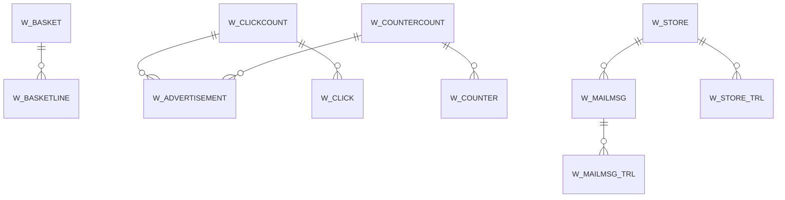

# Area W

11 table(s), 11 in scope.

| table | class | scope | rows | description |
|---|---|---|---|---|
| [W_ADVERTISEMENT](../../data-model/w/w_advertisement.md) | business | in | 1 |  |
| [W_BASKET](../../data-model/w/w_basket.md) | business | in | 0 |  |
| [W_BASKETLINE](../../data-model/w/w_basketline.md) | business | in | 0 |  |
| [W_CLICK](../../data-model/w/w_click.md) | business | in | 0 |  |
| [W_CLICKCOUNT](../../data-model/w/w_clickcount.md) | business | in | 1 |  |
| [W_COUNTER](../../data-model/w/w_counter.md) | business | in | 0 |  |
| [W_COUNTERCOUNT](../../data-model/w/w_countercount.md) | business | in | 1 |  |
| [W_MAILMSG](../../data-model/w/w_mailmsg.md) | business | in | 0 |  |
| [W_MAILMSG_TRL](../../data-model/w/w_mailmsg_trl.md) | translation | in | 0 |  |
| [W_STORE](../../data-model/w/w_store.md) | business | in | 1 |  |
| [W_STORE_TRL](../../data-model/w/w_store_trl.md) | translation | in | 1 |  |
