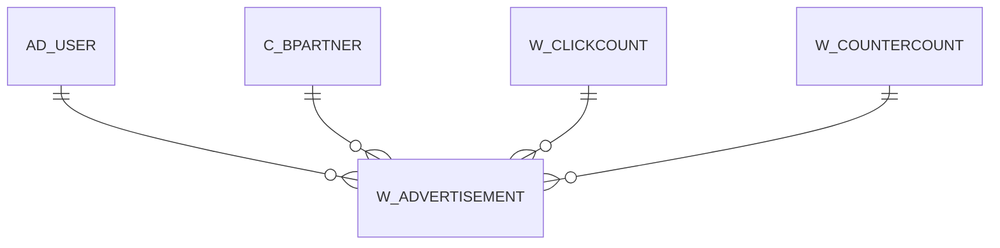

# W_ADVERTISEMENT

Area [W](../../data-model/w/index.md) · class **business** (proposed) · read from database `idempiere-db` (owner `ADEMPIERE`) · 1 row(s) when profiled

## Columns

| column | type | key | not null | business name | references (code) | nulls | distinct |
|---|---|---|---|---|---|---|---|
| `W_ADVERTISEMENT_ID` | NUMBER(10,0) | PK | yes |  |  | 0 | 1 |
| `AD_CLIENT_ID` | NUMBER(10,0) |  | yes |  |  | 0 | 1 |
| `AD_ORG_ID` | NUMBER(10,0) |  | yes |  |  | 0 | 1 |
| `ISACTIVE` | CHAR(1) |  | yes |  |  | 0 | 1 |
| `CREATED` | DATE |  | yes |  |  | 0 | 1 |
| `CREATEDBY` | NUMBER(10,0) |  | yes |  |  | 0 | 1 |
| `UPDATED` | DATE |  | yes |  |  | 0 | 1 |
| `UPDATEDBY` | NUMBER(10,0) |  | yes |  |  | 0 | 1 |
| `NAME` | VARCHAR2(60 CHAR) |  | yes |  |  | 0 | 1 |
| `DESCRIPTION` | VARCHAR2(255 CHAR) |  |  |  |  | 0 | 1 |
| `HELP` | VARCHAR2(2000 CHAR) |  |  |  |  | 0 | 1 |
| `ISSELFSERVICE` | CHAR(1) |  | yes |  |  | 0 | 1 |
| `C_BPARTNER_ID` | NUMBER(10,0) |  | yes |  |  | 0 | 1 |
| `AD_USER_ID` | NUMBER(10,0) |  |  |  |  | 0 | 1 |
| `W_CLICKCOUNT_ID` | NUMBER(10,0) |  |  |  |  | 0 | 1 |
| `W_COUNTERCOUNT_ID` | NUMBER(10,0) |  |  |  |  | 0 | 1 |
| `VALIDFROM` | DATE |  |  |  |  | 1 | 0 |
| `VALIDTO` | DATE |  |  |  |  | 1 | 0 |
| `IMAGEURL` | VARCHAR2(120 CHAR) |  |  |  |  | 0 | 1 |
| `ADTEXT` | VARCHAR2(2000 CHAR) |  |  |  |  | 0 | 1 |
| `WEBPARAM1` | VARCHAR2(2000 CHAR) |  |  |  |  | 0 | 1 |
| `WEBPARAM2` | VARCHAR2(2000 CHAR) |  |  |  |  | 0 | 1 |
| `WEBPARAM3` | VARCHAR2(2000 CHAR) |  |  |  |  | 0 | 1 |
| `WEBPARAM4` | VARCHAR2(2000 CHAR) |  |  |  |  | 0 | 1 |
| `PUBLISHSTATUS` | CHAR(1) |  | yes |  |  | 0 | 1 |
| `VERSION` | NUMBER(10,0) |  |  |  |  | 1 | 0 |
| `PROCESSING` | CHAR(1) |  |  |  |  | 1 | 0 |
| `W_ADVERTISEMENT_UU` | VARCHAR2(36 CHAR) |  |  |  |  | 0 | 1 |

*references (code)* is the table the application model's code says a column points to; *Foreign keys* below are the constraints the database declares. Counts come from the profile; no value is ever shown.

## Foreign keys

**References**

| table | columns | on delete |
|---|---|---|
| [AD_USER](../../data-model/ad/ad_user.md) | W_ADVERTISEMENT.AD_USER_ID → AD_USER.AD_USER_ID | NO ACTION |
| [C_BPARTNER](../../data-model/c/c_bpartner.md) | W_ADVERTISEMENT.C_BPARTNER_ID → C_BPARTNER.C_BPARTNER_ID | NO ACTION |
| [W_CLICKCOUNT](../../data-model/w/w_clickcount.md) | W_ADVERTISEMENT.W_CLICKCOUNT_ID → W_CLICKCOUNT.W_CLICKCOUNT_ID | NO ACTION |
| [W_COUNTERCOUNT](../../data-model/w/w_countercount.md) | W_ADVERTISEMENT.W_COUNTERCOUNT_ID → W_COUNTERCOUNT.W_COUNTERCOUNT_ID | NO ACTION |

**Referenced by**

_None._

## Write behaviour

- updates: **po_only**
- deletes: **deleted_by_users**
- change log: **recorded**
- evidence: 1 citation(s)

## Schema history

42 change(s); the latest:

| applied | release | operation | column | tickets |
|---|---|---|---|---|
| 2023-04-09T15:47 | iD11 | `add_constraint` |  | IDEMPIERE-5567 |
| 2023-04-09T15:47 | iD11 | `add_constraint` |  | IDEMPIERE-5567 |
| 2021-12-05T16:45 | i8.2z | `add_constraint` |  | IDEMPIERE-5075 |
| 2021-12-05T16:45 | i8.2z | `add_constraint` |  | IDEMPIERE-5075 |
| 2021-12-05T16:45 | i8.2z | `drop_constraint` |  | IDEMPIERE-5075 |
| 2021-12-05T16:45 | i8.2z | `add_constraint` |  | IDEMPIERE-5075 |
| 2021-12-05T16:45 | i8.2z | `drop_constraint` |  | IDEMPIERE-5075 |
| 2021-12-05T16:45 | i8.2z | `add_constraint` |  | IDEMPIERE-5075 |
| 2021-12-05T16:45 | i8.2z | `drop_constraint` |  | IDEMPIERE-5075 |
| 2021-12-05T16:45 | i8.2z | `drop_constraint` |  | IDEMPIERE-5075 |
| 2020-08-04T01:00 | i7.1z | `add_column` | tmp_col_8_tmp | IDEMPIERE-3862 |
| 2020-08-04T01:00 | i7.1z | `drop_column` | tmp_col_3_tmp | IDEMPIERE-3862 |
| 2020-08-04T01:00 | i7.1z | `drop_column` | tmp_col_1_tmp | IDEMPIERE-3862 |
| 2020-08-04T01:00 | i7.1z | `modify_column` | WEBPARAM4 | IDEMPIERE-3862 |
| 2020-08-04T01:00 | i7.1z | `add_column` | tmp_col_1_tmp | IDEMPIERE-3862 |

## Open conflicts

| type | attribute | explanation |
|---|---|---|
| `table_without_model` | `model_class` | unexplained |

## Notes

<!-- ekos:manual id="table.w_advertisement.notes" -->
_Business notes about this table._
<!-- /ekos:manual -->
