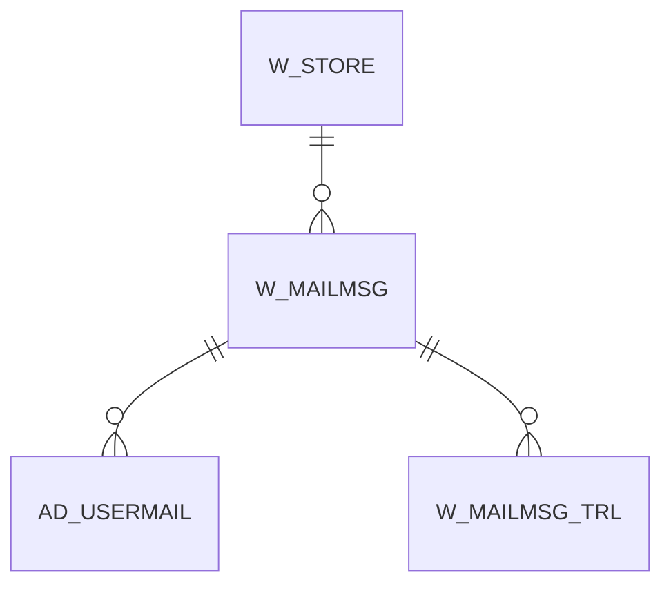

# W_MAILMSG

Area [W](../../data-model/w/index.md) · class **business** (proposed) · read from database `idempiere-db` (owner `ADEMPIERE`) · 0 row(s) when profiled

## Columns

| column | type | key | not null | business name | references (code) | nulls | distinct |
|---|---|---|---|---|---|---|---|
| `W_MAILMSG_ID` | NUMBER(10,0) | PK | yes |  |  | 0 | 0 |
| `AD_CLIENT_ID` | NUMBER(10,0) |  | yes |  |  | 0 | 0 |
| `AD_ORG_ID` | NUMBER(10,0) |  | yes |  |  | 0 | 0 |
| `ISACTIVE` | CHAR(1) |  | yes |  |  | 0 | 0 |
| `CREATED` | DATE |  | yes |  |  | 0 | 0 |
| `CREATEDBY` | NUMBER(10,0) |  | yes |  |  | 0 | 0 |
| `UPDATED` | DATE |  | yes |  |  | 0 | 0 |
| `UPDATEDBY` | NUMBER(10,0) |  | yes |  |  | 0 | 0 |
| `NAME` | VARCHAR2(60 CHAR) |  | yes |  |  | 0 | 0 |
| `DESCRIPTION` | VARCHAR2(255 CHAR) |  |  |  |  | 0 | 0 |
| `W_STORE_ID` | NUMBER(10,0) |  | yes |  |  | 0 | 0 |
| `MAILMSGTYPE` | CHAR(2) |  | yes |  |  | 0 | 0 |
| `SUBJECT` | VARCHAR2(255 CHAR) |  | yes |  |  | 0 | 0 |
| `MESSAGE` | VARCHAR2(2000 CHAR) |  | yes |  |  | 0 | 0 |
| `MESSAGE2` | VARCHAR2(2000 CHAR) |  |  |  |  | 0 | 0 |
| `MESSAGE3` | VARCHAR2(2000 CHAR) |  |  |  |  | 0 | 0 |
| `W_MAILMSG_UU` | VARCHAR2(36 CHAR) |  |  |  |  | 0 | 0 |

*references (code)* is the table the application model's code says a column points to; *Foreign keys* below are the constraints the database declares. Counts come from the profile; no value is ever shown.

## Check constraints

| name | expression |
|---|---|
| `SYS_C0020277` | `IsActive in ('Y','N')` |

## Foreign keys

**References**

| table | columns | on delete |
|---|---|---|
| [W_STORE](../../data-model/w/w_store.md) | W_MAILMSG.W_STORE_ID → W_STORE.W_STORE_ID | CASCADE |

**Referenced by**

| table | columns | on delete |
|---|---|---|
| [AD_USERMAIL](../../data-model/ad/ad_usermail.md) | AD_USERMAIL.W_MAILMSG_ID → W_MAILMSG.W_MAILMSG_ID | CASCADE |
| [W_MAILMSG_TRL](../../data-model/w/w_mailmsg_trl.md) | W_MAILMSG_TRL.W_MAILMSG_ID → W_MAILMSG.W_MAILMSG_ID | CASCADE |

## Write behaviour

- updates: **po_only**
- deletes: **deleted_by_users, deleted_by_cascade**
- change log: **recorded**
- evidence: 2 citation(s)

## Schema history

31 change(s); the latest:

| applied | release | operation | column | tickets |
|---|---|---|---|---|
| 2023-04-09T15:47 | iD11 | `add_constraint` |  | IDEMPIERE-5567 |
| 2023-04-09T15:47 | iD11 | `add_constraint` |  | IDEMPIERE-5567 |
| 2021-12-05T16:45 | i8.2z | `add_constraint` |  | IDEMPIERE-5075 |
| 2021-12-05T16:45 | i8.2z | `drop_constraint` |  | IDEMPIERE-5075 |
| 2020-08-04T01:00 | i7.1z | `modify_column` | MESSAGE2 | IDEMPIERE-3862 |
| 2020-08-04T01:00 | i7.1z | `drop_column` | tmp_col_3_tmp | IDEMPIERE-3862 |
| 2020-08-04T01:00 | i7.1z | `drop_column` | tmp_col_7_tmp | IDEMPIERE-3862 |
| 2020-08-04T01:00 | i7.1z | `modify_column` | SUBJECT | IDEMPIERE-3862 |
| 2020-08-04T01:00 | i7.1z | `add_column` | tmp_col_4_tmp | IDEMPIERE-3862 |
| 2020-08-04T01:00 | i7.1z | `modify_column` | MESSAGE3 | IDEMPIERE-3862 |
| 2020-08-04T01:00 | i7.1z | `modify_column` | W_MAILMSG_UU | IDEMPIERE-3862 |
| 2020-08-04T01:00 | i7.1z | `modify_column` | NAME | IDEMPIERE-3862 |
| 2020-08-04T01:00 | i7.1z | `modify_column` | NAME | IDEMPIERE-3862 |
| 2020-08-04T01:00 | i7.1z | `drop_column` | tmp_col_1_tmp | IDEMPIERE-3862 |
| 2020-08-04T01:00 | i7.1z | `modify_column` | MESSAGE | IDEMPIERE-3862 |

## Open conflicts

| type | attribute | explanation |
|---|---|---|
| `table_without_model` | `model_class` | unexplained |

## Notes

<!-- ekos:manual id="table.w_mailmsg.notes" -->
_Business notes about this table._
<!-- /ekos:manual -->
