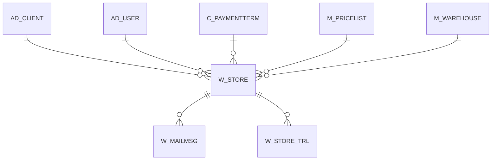

# W_STORE

Area [W](../../data-model/w/index.md) · class **business** (proposed) · read from database `idempiere-db` (owner `ADEMPIERE`) · 1 row(s) when profiled

## Columns

| column | type | key | not null | business name | references (code) | nulls | distinct |
|---|---|---|---|---|---|---|---|
| `W_STORE_ID` | NUMBER(10,0) | PK | yes |  |  | 0 | 1 |
| `AD_CLIENT_ID` | NUMBER(10,0) |  | yes |  |  | 0 | 1 |
| `AD_ORG_ID` | NUMBER(10,0) |  | yes |  |  | 0 | 1 |
| `ISACTIVE` | CHAR(1) |  | yes |  |  | 0 | 1 |
| `CREATED` | DATE |  | yes |  |  | 0 | 1 |
| `CREATEDBY` | NUMBER(10,0) |  | yes |  |  | 0 | 1 |
| `UPDATED` | DATE |  | yes |  |  | 0 | 1 |
| `UPDATEDBY` | NUMBER(10,0) |  | yes |  |  | 0 | 1 |
| `NAME` | VARCHAR2(60 CHAR) |  | yes |  |  | 0 | 1 |
| `DESCRIPTION` | VARCHAR2(255 CHAR) |  |  |  |  | 1 | 0 |
| `HELP` | VARCHAR2(2000 CHAR) |  |  |  |  | 1 | 0 |
| `WSTOREEMAIL` | VARCHAR2(60 CHAR) |  |  |  |  | 1 | 0 |
| `WSTOREUSER` | VARCHAR2(60 CHAR) |  |  |  |  | 1 | 0 |
| `WSTOREUSERPW` | VARCHAR2(20 CHAR) |  |  |  |  | 1 | 0 |
| `WEBINFO` | VARCHAR2(2000 CHAR) |  |  |  |  | 1 | 0 |
| `WEBPARAM1` | VARCHAR2(2000 CHAR) |  |  |  |  | 0 | 1 |
| `WEBPARAM2` | VARCHAR2(2000 CHAR) |  |  |  |  | 0 | 1 |
| `WEBPARAM3` | VARCHAR2(2000 CHAR) |  |  |  |  | 0 | 1 |
| `WEBPARAM4` | VARCHAR2(2000 CHAR) |  |  |  |  | 0 | 1 |
| `WEBPARAM5` | VARCHAR2(2000 CHAR) |  |  |  |  | 0 | 1 |
| `WEBPARAM6` | VARCHAR2(2000 CHAR) |  |  |  |  | 0 | 1 |
| `ISMENUASSETS` | CHAR(1) |  | yes |  |  | 0 | 1 |
| `ISMENUORDERS` | CHAR(1) |  | yes |  |  | 0 | 1 |
| `ISMENUINVOICES` | CHAR(1) |  | yes |  |  | 0 | 1 |
| `ISMENUSHIPMENTS` | CHAR(1) |  | yes |  |  | 0 | 1 |
| `ISMENUPAYMENTS` | CHAR(1) |  | yes |  |  | 0 | 1 |
| `ISMENURFQS` | CHAR(1) |  | yes |  |  | 0 | 1 |
| `ISMENUREQUESTS` | CHAR(1) |  | yes |  |  | 0 | 1 |
| `ISMENUINTERESTS` | CHAR(1) |  | yes |  |  | 0 | 1 |
| `ISMENUREGISTRATIONS` | CHAR(1) |  | yes |  |  | 0 | 1 |
| `ISMENUCONTACT` | CHAR(1) |  | yes |  |  | 0 | 1 |
| `EMAILHEADER` | VARCHAR2(2000 CHAR) |  |  |  |  | 1 | 0 |
| `EMAILFOOTER` | VARCHAR2(2000 CHAR) |  |  |  |  | 1 | 0 |
| `SALESREP_ID` | NUMBER(10,0) |  | yes |  |  | 0 | 1 |
| `M_WAREHOUSE_ID` | NUMBER(10,0) |  | yes |  |  | 0 | 1 |
| `M_PRICELIST_ID` | NUMBER(10,0) |  | yes |  |  | 0 | 1 |
| `WEBCONTEXT` | VARCHAR2(20 CHAR) |  | yes |  |  | 0 | 1 |
| `WEBORDEREMAIL` | VARCHAR2(60 CHAR) |  |  |  |  | 1 | 0 |
| `C_PAYMENTTERM_ID` | NUMBER(10,0) |  |  |  |  | 0 | 1 |
| `ISDEFAULT` | CHAR(1) |  | yes |  |  | 0 | 1 |
| `URL` | VARCHAR2(120 CHAR) |  | yes |  |  | 0 | 1 |
| `STYLESHEET` | VARCHAR2(60 CHAR) |  |  |  |  | 0 | 1 |
| `W_STORE_UU` | VARCHAR2(36 CHAR) |  |  |  |  | 0 | 1 |

*references (code)* is the table the application model's code says a column points to; *Foreign keys* below are the constraints the database declares. Counts come from the profile; no value is ever shown.

## Check constraints

| name | expression |
|---|---|
| `SYS_C0022056` | `IsActive in ('Y','N')` |
| `SYS_C0022057` | `IsMenuInterests in ('Y','N')` |
| `SYS_C0022058` | `IsMenuRegistrations in ('Y','N')` |
| `SYS_C0022059` | `IsMenuRFQs in ('Y','N')` |
| `SYS_C0022060` | `IsMenuOrders in ('Y','N')` |
| `SYS_C0022062` | `"ISMENUSHIPMENTS"='Y' OR "ISMENUSHIPMENTS"='N'` |
| `SYS_C0022063` | `IsMenuRequests in ('Y','N')` |
| `SYS_C0022064` | `IsMenuContact in ('Y','N')` |
| `SYS_C0022066` | `"ISMENUPAYMENTS"='Y' OR "ISMENUPAYMENTS"='N'` |
| `SYS_C0022067` | `IsMenuInvoices in ('Y','N')` |
| `SYS_C0022068` | `IsMenuAssets in ('Y','N')` |

## Foreign keys

**References**

| table | columns | on delete |
|---|---|---|
| [AD_CLIENT](../../data-model/ad/ad_client.md) | W_STORE.AD_CLIENT_ID → AD_CLIENT.AD_CLIENT_ID | NO ACTION |
| [AD_USER](../../data-model/ad/ad_user.md) | W_STORE.SALESREP_ID → AD_USER.AD_USER_ID | NO ACTION |
| [C_PAYMENTTERM](../../data-model/c/c_paymentterm.md) | W_STORE.C_PAYMENTTERM_ID → C_PAYMENTTERM.C_PAYMENTTERM_ID | NO ACTION |
| [M_PRICELIST](../../data-model/m/m_pricelist.md) | W_STORE.M_PRICELIST_ID → M_PRICELIST.M_PRICELIST_ID | NO ACTION |
| [M_WAREHOUSE](../../data-model/m/m_warehouse.md) | W_STORE.M_WAREHOUSE_ID → M_WAREHOUSE.M_WAREHOUSE_ID | NO ACTION |

**Referenced by**

| table | columns | on delete |
|---|---|---|
| [W_MAILMSG](../../data-model/w/w_mailmsg.md) | W_MAILMSG.W_STORE_ID → W_STORE.W_STORE_ID | CASCADE |
| [W_STORE_TRL](../../data-model/w/w_store_trl.md) | W_STORE_TRL.W_STORE_ID → W_STORE.W_STORE_ID | CASCADE |

## Write behaviour

- updates: **po_only**
- deletes: **deleted_by_users**
- change log: **recorded**
- evidence: 1 citation(s)

## Schema history

78 change(s); the latest:

| applied | release | operation | column | tickets |
|---|---|---|---|---|
| 2023-04-09T15:47 | iD11 | `add_constraint` |  | IDEMPIERE-5567 |
| 2023-04-09T15:47 | iD11 | `add_constraint` |  | IDEMPIERE-5567 |
| 2021-12-05T16:45 | i8.2z | `add_constraint` |  | IDEMPIERE-5075 |
| 2021-12-05T16:45 | i8.2z | `drop_constraint` |  | IDEMPIERE-5075 |
| 2021-12-05T16:45 | i8.2z | `drop_constraint` |  | IDEMPIERE-5075 |
| 2021-12-05T16:45 | i8.2z | `add_constraint` |  | IDEMPIERE-5075 |
| 2021-12-05T16:45 | i8.2z | `add_constraint` |  | IDEMPIERE-5075 |
| 2021-12-05T16:45 | i8.2z | `drop_constraint` |  | IDEMPIERE-5075 |
| 2021-12-05T16:45 | i8.2z | `add_constraint` |  | IDEMPIERE-5075 |
| 2021-12-05T16:45 | i8.2z | `drop_constraint` |  | IDEMPIERE-5075 |
| 2021-12-05T16:45 | i8.2z | `add_constraint` |  | IDEMPIERE-5075 |
| 2021-12-05T16:45 | i8.2z | `drop_constraint` |  | IDEMPIERE-5075 |
| 2020-08-04T01:00 | i7.1z | `modify_column` | EMAILHEADER | IDEMPIERE-3862 |
| 2020-08-04T01:00 | i7.1z | `modify_column` | NAME | IDEMPIERE-3862 |
| 2020-08-04T01:00 | i7.1z | `modify_column` | WEBCONTEXT | IDEMPIERE-3862 |

## Open conflicts

| type | attribute | explanation |
|---|---|---|
| `table_without_model` | `model_class` | unexplained |

## Notes

<!-- ekos:manual id="table.w_store.notes" -->
_Business notes about this table._
<!-- /ekos:manual -->
