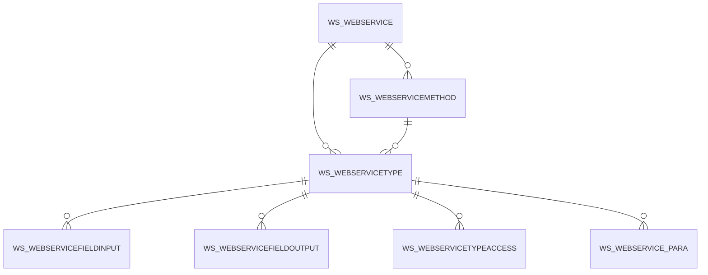

# Area WS

7 table(s), 7 in scope.

| table | class | scope | rows | description |
|---|---|---|---|---|
| [WS_WEBSERVICE](../../data-model/ws/ws_webservice.md) | business | in | 2 |  |
| [WS_WEBSERVICEFIELDINPUT](../../data-model/ws/ws_webservicefieldinput.md) | business | in | 45 |  |
| [WS_WEBSERVICEFIELDOUTPUT](../../data-model/ws/ws_webservicefieldoutput.md) | business | in | 8 |  |
| [WS_WEBSERVICEMETHOD](../../data-model/ws/ws_webservicemethod.md) | business | in | 9 |  |
| [WS_WEBSERVICETYPE](../../data-model/ws/ws_webservicetype.md) | business | in | 16 |  |
| [WS_WEBSERVICETYPEACCESS](../../data-model/ws/ws_webservicetypeaccess.md) | business | in | 16 |  |
| [WS_WEBSERVICE_PARA](../../data-model/ws/ws_webservice_para.md) | business | in | 46 |  |
