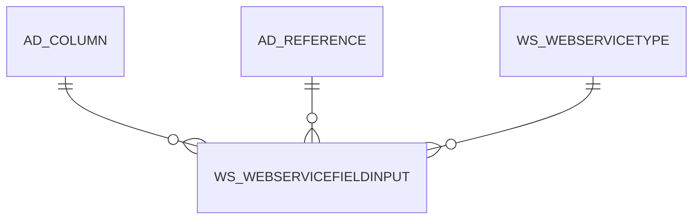

# WS_WEBSERVICEFIELDINPUT

Area [WS](../../data-model/ws/index.md) · class **business** (proposed) · read from database `idempiere-db` (owner `ADEMPIERE`) · 45 row(s) when profiled

Application model: `org.idempiere.webservices.model.X_WS_WebServiceFieldInput`, access level 6 - System - Client.

## Columns

| column | type | key | not null | business name | references (code) | nulls | distinct |
|---|---|---|---|---|---|---|---|
| `AD_CLIENT_ID` | NUMBER(10,0) |  | yes | Tenant |  | 0 | 1 |
| `AD_COLUMN_ID` | NUMBER(10,0) |  |  | Column | [AD_COLUMN](../../data-model/ad/ad_column.md) | 0 | 44 |
| `AD_ORG_ID` | NUMBER(10,0) |  | yes | Organization |  | 0 | 1 |
| `CREATED` | DATE |  | yes | Created |  | 0 | 24 |
| `CREATEDBY` | NUMBER(10,0) |  |  | Created By |  | 0 | 1 |
| `ISACTIVE` | CHAR(1) |  | yes | Active |  | 0 | 1 |
| `UPDATED` | DATE |  | yes | Updated |  | 0 | 24 |
| `UPDATEDBY` | NUMBER(10,0) |  |  | Updated By |  | 0 | 1 |
| `WS_WEBSERVICEFIELDINPUT_ID` | NUMBER(10,0) | PK | yes | Web Service Field Input |  | 0 | 45 |
| `WS_WEBSERVICETYPE_ID` | NUMBER(10,0) |  | yes | Web Service Type | [WS_WEBSERVICETYPE](../../data-model/ws/ws_webservicetype.md) | 0 | 8 |
| `AD_REFERENCE_ID` | NUMBER(10,0) |  |  | Reference | [AD_REFERENCE](../../data-model/ad/ad_reference.md) | 9 | 10 |
| `COLUMNNAME` | VARCHAR2(63 CHAR) |  |  | DB Column Name |  | 45 | 0 |
| `IDENTIFIERLOGIC` | VARCHAR2(2000 CHAR) |  |  | Identifier Logic |  | 45 | 0 |
| `ISIDENTIFIER` | CHAR(1) |  |  | Identifier |  | 0 | 2 |
| `ISNULLIDENTIFIER` | CHAR(1) |  |  | Allow Null Value |  | 0 | 1 |
| `WS_WEBSERVICEFIELDINPUT_UU` | VARCHAR2(36 CHAR) |  |  | WS_WebServiceFieldInput_UU |  | 0 | 45 |
| `AD_REFERENCE_VALUE_ID` | NUMBER(10,0) |  |  | Reference Key | [AD_REFERENCE](../../data-model/ad/ad_reference.md) | 42 | 3 |

*references (code)* is the table the application model's code says a column points to; *Foreign keys* below are the constraints the database declares. Counts come from the profile; no value is ever shown.

## Check constraints

| name | expression |
|---|---|
| `SYS_C0021300` | `IsActive IN ('Y','N')` |
| `SYS_C0021302` | `IsNullIdentifier IN ('Y','N')` |
| `SYS_C0021304` | `IsIdentifier IN ('Y','N')` |

## Foreign keys

**References**

| table | columns | on delete |
|---|---|---|
| [AD_COLUMN](../../data-model/ad/ad_column.md) | WS_WEBSERVICEFIELDINPUT.AD_COLUMN_ID → AD_COLUMN.AD_COLUMN_ID | NO ACTION |
| [AD_REFERENCE](../../data-model/ad/ad_reference.md) | WS_WEBSERVICEFIELDINPUT.AD_REFERENCE_VALUE_ID → AD_REFERENCE.AD_REFERENCE_ID | NO ACTION |
| [WS_WEBSERVICETYPE](../../data-model/ws/ws_webservicetype.md) | WS_WEBSERVICEFIELDINPUT.WS_WEBSERVICETYPE_ID → WS_WEBSERVICETYPE.WS_WEBSERVICETYPE_ID | NO ACTION |

**Referenced by**

_None._

## Write behaviour

- updates: **po_only**
- deletes: **deleted_by_users**
- change log: **recorded**
- evidence: 1 citation(s)

## Schema history

59 change(s); the latest:

| applied | release | operation | column | tickets |
|---|---|---|---|---|
| 2024-04-03T12:26 | iD11 | `modify_column` | ColumnName | IDEMPIERE-6064 |
| 2024-04-03T12:26 | iD11 | `modify_column` | ColumnName | IDEMPIERE-6064 |
| 2023-04-09T15:47 | iD11 | `add_constraint` |  | IDEMPIERE-5567 |
| 2023-04-09T15:47 | iD11 | `add_constraint` |  | IDEMPIERE-5567 |
| 2020-08-04T01:00 | i7.1z | `add_column` | tmp_col_1_tmp | IDEMPIERE-3862 |
| 2020-08-04T01:00 | i7.1z | `modify_column` | COLUMNNAME | IDEMPIERE-3862 |
| 2020-08-04T01:00 | i7.1z | `modify_column` | IDENTIFIERLOGIC | IDEMPIERE-3862 |
| 2020-08-04T01:00 | i7.1z | `modify_column` | WS_WEBSERVICEFIELDINPUT_UU | IDEMPIERE-3862 |
| 2020-08-04T01:00 | i7.1z | `drop_column` | tmp_col_1_tmp | IDEMPIERE-3862 |
| 2020-08-04T01:00 | i7.1z | `add_column` | tmp_col_2_tmp | IDEMPIERE-3862 |
| 2020-08-04T01:00 | i7.1z | `drop_column` | tmp_col_2_tmp | IDEMPIERE-3862 |
| 2020-08-04T01:00 | i7.1z | `drop_column` | tmp_col_3_tmp | IDEMPIERE-3862 |
| 2020-08-04T01:00 | i7.1z | `add_column` | tmp_col_3_tmp | IDEMPIERE-3862 |
| 2014-05-02T10:09 | i2.0 | `modify_column` | updated | IDEMPIERE-709 |
| 2014-05-02T10:09 | i2.0 | `modify_column` | created | IDEMPIERE-709 |

## Notes

<!-- ekos:manual id="table.ws_webservicefieldinput.notes" -->
_Business notes about this table._
<!-- /ekos:manual -->
