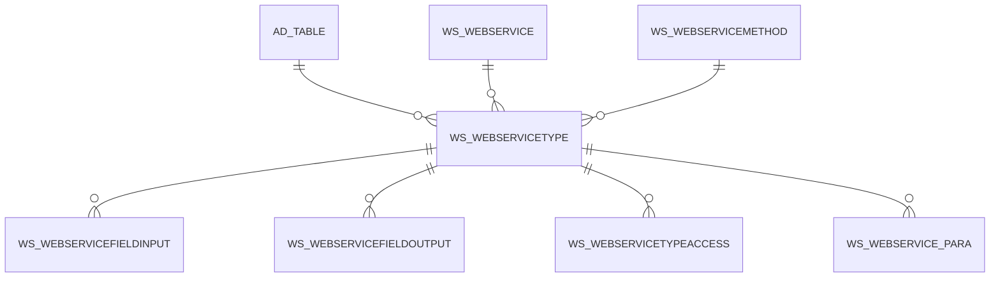

# WS_WEBSERVICETYPE

Area [WS](../../data-model/ws/index.md) · class **business** (proposed) · read from database `idempiere-db` (owner `ADEMPIERE`) · 16 row(s) when profiled

Application model: `org.idempiere.webservices.model.X_WS_WebServiceType`, access level 6 - System - Client.

## Columns

| column | type | key | not null | business name | references (code) | nulls | distinct |
|---|---|---|---|---|---|---|---|
| `AD_CLIENT_ID` | NUMBER(10,0) |  | yes | Tenant |  | 0 | 1 |
| `AD_ORG_ID` | NUMBER(10,0) |  | yes | Organization |  | 0 | 1 |
| `AD_TABLE_ID` | NUMBER(10,0) |  |  | Table | [AD_TABLE](../../data-model/ad/ad_table.md) | 3 | 7 |
| `CREATED` | DATE |  | yes | Created |  | 0 | 15 |
| `CREATEDBY` | NUMBER(10,0) |  | yes | Created By |  | 0 | 1 |
| `DESCRIPTION` | VARCHAR2(255 CHAR) |  |  | Description |  | 14 | 2 |
| `HELP` | VARCHAR2(2000 CHAR) |  |  | Comment/Help |  | 16 | 0 |
| `ISACTIVE` | CHAR(1) |  | yes | Active |  | 0 | 1 |
| `NAME` | VARCHAR2(60 CHAR) |  | yes | Name |  | 0 | 16 |
| `UPDATED` | DATE |  | yes | Updated |  | 0 | 15 |
| `UPDATEDBY` | NUMBER(10,0) |  | yes | Updated By |  | 0 | 1 |
| `VALUE` | VARCHAR2(40 CHAR) |  | yes | Search Key |  | 0 | 16 |
| `WS_WEBSERVICE_ID` | NUMBER(10,0) |  | yes | Web Service | [WS_WEBSERVICE](../../data-model/ws/ws_webservice.md) | 0 | 2 |
| `WS_WEBSERVICEMETHOD_ID` | NUMBER(10,0) |  | yes | Web Service Method | [WS_WEBSERVICEMETHOD](../../data-model/ws/ws_webservicemethod.md) | 0 | 9 |
| `WS_WEBSERVICETYPE_ID` | NUMBER(10,0) | PK | yes | Web Service Type |  | 0 | 16 |
| `WS_WEBSERVICETYPE_UU` | VARCHAR2(36 CHAR) |  |  | WS_WebServiceType_UU |  | 0 | 16 |
| `INSERTPARAMETERS` | CHAR(1) |  |  | Create Default Parameters |  | 16 | 0 |

*references (code)* is the table the application model's code says a column points to; *Foreign keys* below are the constraints the database declares. Counts come from the profile; no value is ever shown.

## Check constraints

| name | expression |
|---|---|
| `SYS_C0020453` | `IsActive IN ('Y','N')` |

## Foreign keys

**References**

| table | columns | on delete |
|---|---|---|
| [AD_TABLE](../../data-model/ad/ad_table.md) | WS_WEBSERVICETYPE.AD_TABLE_ID → AD_TABLE.AD_TABLE_ID | NO ACTION |
| [WS_WEBSERVICE](../../data-model/ws/ws_webservice.md) | WS_WEBSERVICETYPE.WS_WEBSERVICE_ID → WS_WEBSERVICE.WS_WEBSERVICE_ID | NO ACTION |
| [WS_WEBSERVICEMETHOD](../../data-model/ws/ws_webservicemethod.md) | WS_WEBSERVICETYPE.WS_WEBSERVICEMETHOD_ID → WS_WEBSERVICEMETHOD.WS_WEBSERVICEMETHOD_ID | NO ACTION |

**Referenced by**

| table | columns | on delete |
|---|---|---|
| [WS_WEBSERVICEFIELDINPUT](../../data-model/ws/ws_webservicefieldinput.md) | WS_WEBSERVICEFIELDINPUT.WS_WEBSERVICETYPE_ID → WS_WEBSERVICETYPE.WS_WEBSERVICETYPE_ID | NO ACTION |
| [WS_WEBSERVICEFIELDOUTPUT](../../data-model/ws/ws_webservicefieldoutput.md) | WS_WEBSERVICEFIELDOUTPUT.WS_WEBSERVICETYPE_ID → WS_WEBSERVICETYPE.WS_WEBSERVICETYPE_ID | NO ACTION |
| [WS_WEBSERVICETYPEACCESS](../../data-model/ws/ws_webservicetypeaccess.md) | WS_WEBSERVICETYPEACCESS.WS_WEBSERVICETYPE_ID → WS_WEBSERVICETYPE.WS_WEBSERVICETYPE_ID | CASCADE |
| [WS_WEBSERVICE_PARA](../../data-model/ws/ws_webservice_para.md) | WS_WEBSERVICE_PARA.WS_WEBSERVICETYPE_ID → WS_WEBSERVICETYPE.WS_WEBSERVICETYPE_ID | NO ACTION |

## Write behaviour

- updates: **po_only**
- deletes: **deleted_by_users**
- change log: **recorded**
- evidence: 1 citation(s)

## Schema history

58 change(s); the latest:

| applied | release | operation | column | tickets |
|---|---|---|---|---|
| 2023-04-09T15:47 | iD11 | `add_constraint` |  | IDEMPIERE-5567 |
| 2023-04-09T15:47 | iD11 | `add_constraint` |  | IDEMPIERE-5567 |
| 2020-08-04T01:00 | i7.1z | `add_column` | tmp_col_2_tmp | IDEMPIERE-3862 |
| 2020-08-04T01:00 | i7.1z | `modify_column` | NAME | IDEMPIERE-3862 |
| 2020-08-04T01:00 | i7.1z | `add_column` | tmp_col_3_tmp | IDEMPIERE-3862 |
| 2020-08-04T01:00 | i7.1z | `add_column` | tmp_col_4_tmp | IDEMPIERE-3862 |
| 2020-08-04T01:00 | i7.1z | `drop_column` | tmp_col_2_tmp | IDEMPIERE-3862 |
| 2020-08-04T01:00 | i7.1z | `modify_column` | NAME | IDEMPIERE-3862 |
| 2020-08-04T01:00 | i7.1z | `modify_column` | VALUE | IDEMPIERE-3862 |
| 2020-08-04T01:00 | i7.1z | `modify_column` | VALUE | IDEMPIERE-3862 |
| 2020-08-04T01:00 | i7.1z | `add_column` | tmp_col_1_tmp | IDEMPIERE-3862 |
| 2020-08-04T01:00 | i7.1z | `drop_column` | tmp_col_4_tmp | IDEMPIERE-3862 |
| 2020-08-04T01:00 | i7.1z | `modify_column` | NAME | IDEMPIERE-3862 |
| 2020-08-04T01:00 | i7.1z | `modify_column` | DESCRIPTION | IDEMPIERE-3862 |
| 2020-08-04T01:00 | i7.1z | `drop_column` | tmp_col_5_tmp | IDEMPIERE-3862 |

## Notes

<!-- ekos:manual id="table.ws_webservicetype.notes" -->
_Business notes about this table._
<!-- /ekos:manual -->
