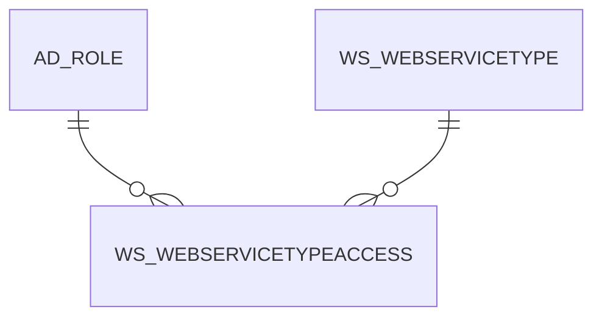

# WS_WEBSERVICETYPEACCESS

Area [WS](../../data-model/ws/index.md) · class **business** (proposed) · read from database `idempiere-db` (owner `ADEMPIERE`) · 16 row(s) when profiled

Application model: `org.idempiere.webservices.model.X_WS_WebServiceTypeAccess`, access level 6 - System - Client.

## Columns

| column | type | key | not null | business name | references (code) | nulls | distinct |
|---|---|---|---|---|---|---|---|
| `AD_CLIENT_ID` | NUMBER(10,0) |  | yes | Tenant |  | 0 | 1 |
| `AD_ORG_ID` | NUMBER(10,0) |  | yes | Organization |  | 0 | 1 |
| `AD_ROLE_ID` | NUMBER(10,0) | PK | yes | Role | [AD_ROLE](../../data-model/ad/ad_role.md) | 0 | 1 |
| `CREATED` | DATE |  | yes | Created |  | 0 | 15 |
| `CREATEDBY` | NUMBER(10,0) |  | yes | Created By |  | 0 | 1 |
| `ISACTIVE` | CHAR(1) |  | yes | Active |  | 0 | 1 |
| `ISREADWRITE` | CHAR(1) |  | yes | Read Write |  | 0 | 1 |
| `UPDATED` | DATE |  | yes | Updated |  | 0 | 14 |
| `UPDATEDBY` | NUMBER(10,0) |  | yes | Updated By |  | 0 | 1 |
| `WS_WEBSERVICETYPE_ID` | NUMBER(10,0) | PK | yes | Web Service Type | [WS_WEBSERVICETYPE](../../data-model/ws/ws_webservicetype.md) | 0 | 16 |
| `WS_WEBSERVICETYPEACCESS_UU` | VARCHAR2(36 CHAR) |  |  | WS_WebServiceTypeAccess_UU |  | 0 | 16 |

*references (code)* is the table the application model's code says a column points to; *Foreign keys* below are the constraints the database declares. Counts come from the profile; no value is ever shown.

## Check constraints

| name | expression |
|---|---|
| `SYS_C0021805` | `IsActive IN ('Y','N')` |
| `SYS_C0021806` | `IsReadWrite IN ('Y','N')` |

## Foreign keys

**References**

| table | columns | on delete |
|---|---|---|
| [AD_ROLE](../../data-model/ad/ad_role.md) | WS_WEBSERVICETYPEACCESS.AD_ROLE_ID → AD_ROLE.AD_ROLE_ID | NO ACTION |
| [WS_WEBSERVICETYPE](../../data-model/ws/ws_webservicetype.md) | WS_WEBSERVICETYPEACCESS.WS_WEBSERVICETYPE_ID → WS_WEBSERVICETYPE.WS_WEBSERVICETYPE_ID | CASCADE |

**Referenced by**

_None._

## Write behaviour

- updates: **po_only**
- deletes: **deleted_by_users, deleted_by_cascade**
- change log: **recorded**
- evidence: 2 citation(s)

## Schema history

35 change(s); the latest:

| applied | release | operation | column | tickets |
|---|---|---|---|---|
| 2023-04-09T15:47 | iD11 | `add_constraint` |  | IDEMPIERE-5567 |
| 2023-04-09T15:47 | iD11 | `add_constraint` |  | IDEMPIERE-5567 |
| 2020-08-04T01:00 | i7.1z | `modify_column` | WS_WEBSERVICETYPEACCESS_UU | IDEMPIERE-3862 |
| 2020-08-04T01:00 | i7.1z | `add_column` | tmp_col_1_tmp | IDEMPIERE-3862 |
| 2020-08-04T01:00 | i7.1z | `drop_column` | tmp_col_1_tmp | IDEMPIERE-3862 |
| 2014-07-16T08:33 | i2.0z | `drop_constraint` |  | IDEMPIERE-2055 |
| 2014-07-16T08:33 | i2.0z | `drop_constraint` |  | IDEMPIERE-2055 |
| 2014-07-16T08:33 | i2.0z | `add_constraint` |  | IDEMPIERE-2055 |
| 2014-07-16T08:33 | i2.0z | `add_constraint` |  | IDEMPIERE-2055 |
| 2014-05-02T10:09 | i2.0 | `modify_column` | created | IDEMPIERE-709 |
| 2014-05-02T10:09 | i2.0 | `modify_column` | updated | IDEMPIERE-709 |
| 2014-04-17T15:00 | i2.0 | `modify_column` | created | IDEMPIERE-709 |
| 2014-04-17T15:00 | i2.0 | `modify_column` | updated | IDEMPIERE-709 |
| 2014-04-17T15:00 | i2.0 | `modify_column` | updated | IDEMPIERE-709 |
| 2014-04-17T15:00 | i2.0 | `modify_column` | created | IDEMPIERE-709 |

## Notes

<!-- ekos:manual id="table.ws_webservicetypeaccess.notes" -->
_Business notes about this table._
<!-- /ekos:manual -->
