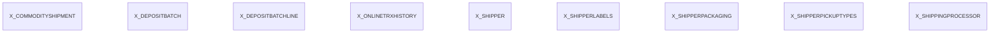

# Area X

9 table(s), 9 in scope.

| table | class | scope | rows | description |
|---|---|---|---|---|
| [X_COMMODITYSHIPMENT](../../data-model/x/x_commodityshipment.md) | unclassified | in |  |  |
| [X_DEPOSITBATCH](../../data-model/x/x_depositbatch.md) | unclassified | in |  |  |
| [X_DEPOSITBATCHLINE](../../data-model/x/x_depositbatchline.md) | unclassified | in |  |  |
| [X_ONLINETRXHISTORY](../../data-model/x/x_onlinetrxhistory.md) | unclassified | in |  |  |
| [X_SHIPPER](../../data-model/x/x_shipper.md) | unclassified | in |  |  |
| [X_SHIPPERLABELS](../../data-model/x/x_shipperlabels.md) | unclassified | in |  |  |
| [X_SHIPPERPACKAGING](../../data-model/x/x_shipperpackaging.md) | unclassified | in |  |  |
| [X_SHIPPERPICKUPTYPES](../../data-model/x/x_shipperpickuptypes.md) | unclassified | in |  |  |
| [X_SHIPPINGPROCESSOR](../../data-model/x/x_shippingprocessor.md) | unclassified | in |  |  |
