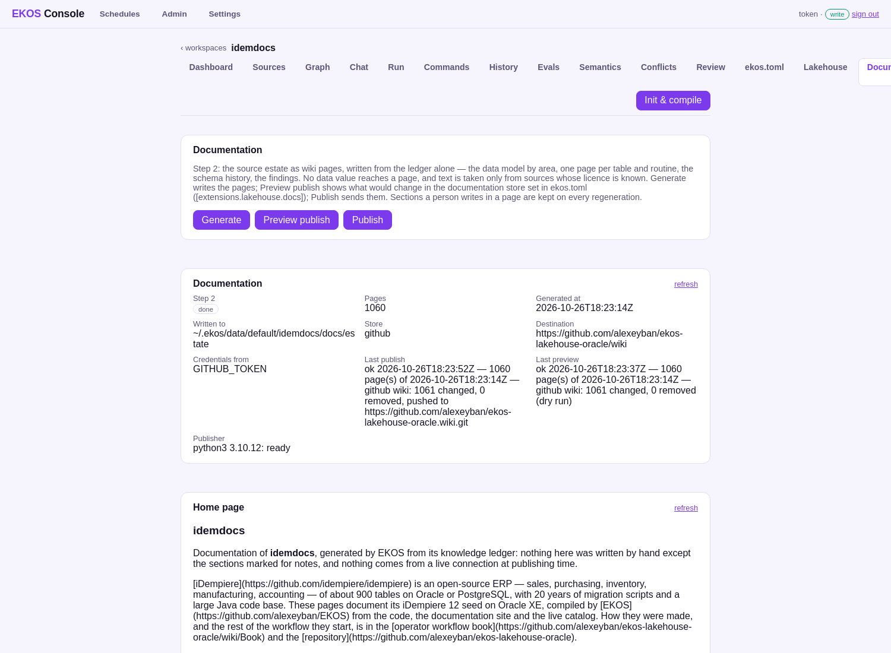

# 3. Step 2 — Documentation

```bash
ekos --project idemdocs docs generate --layout estate --output docs/estate
```

[`docs/estate/`](../estate/index.md) is that command's output, unedited: **1,060 pages** in 26 seconds, from the ledger
alone (no database connection while generating).

| Section | Content |
|---|---|
| [Data model](../estate/data-model/index.md) | 30 functional areas by name prefix, each with an ER diagram; one page per in-scope table (876): columns with business names, the database's foreign keys next to the application model's references, check constraints, who reads and writes it, write behaviour, schema history, open conflicts, a notes section |
| [Glossary](../estate/glossary/index.md) | 3,725 business terms from the application model, each with its columns and where the code states it |
| [Document lifecycles](../estate/lifecycles/index.md) | 26 document types and where each `DocAction` method starts |
| [Logic](../estate/logic/index.md) | 92 routines: language, fidelity, reads, writes, callers, nested statements with their conditions |
| [Schema history](../estate/history/index.md) | 3,356 migration scripts in 28 releases, with tickets |
| [Findings](../estate/findings/index.md) | code ↔ database conflicts by type, invalid objects, write-behaviour classes |

Example: [C_ORDER](../estate/data-model/c/c_order.md).

**What the generator refuses to publish**

- **Values.** A column profile shows null and distinct counts and the table its row count; `min`/`max` are never read.
  Checked on the output: none of C_ORDER's 11 distinctive profile values appears in any page.
- **Text without a licence.** Each source's licence is read from its licence file (`idempiere`: GPL-2.0) or set in
  `[docs-estate] licences` (the database: GPL-2.0, its schema comes from iDempiere's scripts). The docs site has no
  licence file, so none of its text is used. The [home page](../estate/index.md) lists each source, its licence and
  what was left out.

**Scope comes from the review** (step 3): a table gets a page only when it is in scope — decided, or proposed by the
class rules (`T_*` transient, `I_*` import, … are out by default).

**Published from the console** (EKOS RFC 0230): the project names its store in `[extensions.lakehouse.docs]`
(here: this repository's wiki), and the **Documentation** page runs **Generate**, **Preview publish** and **Publish**.
The result is **[this repository's wiki](https://github.com/alexeyban/ekos-lakehouse-oracle/wiki)** — 1,060 pages and
the sidebar, pushed by `lakehouse docs publish` on 2026-10-26; step 2 then reads *done*. The same folder can go to
Confluence or an Azure DevOps wiki; GitHub also renders it right here, Mermaid diagrams included.


