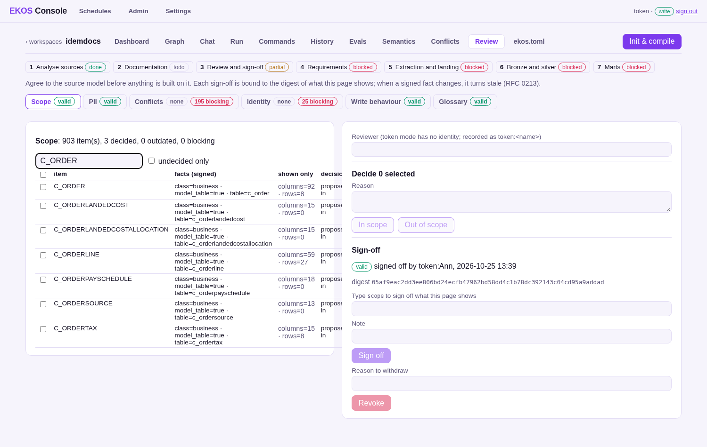
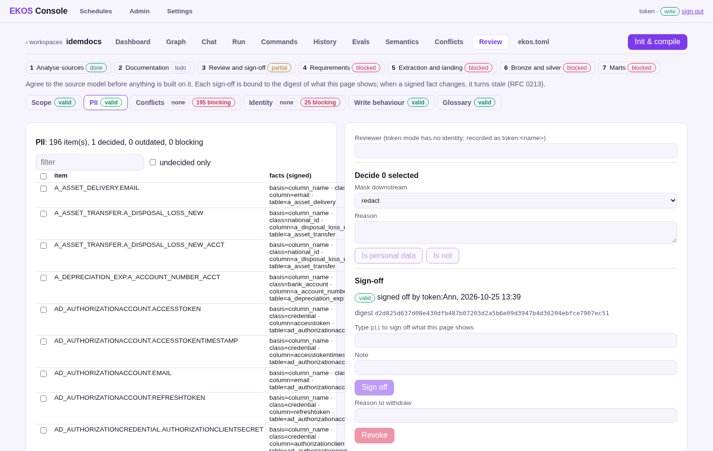
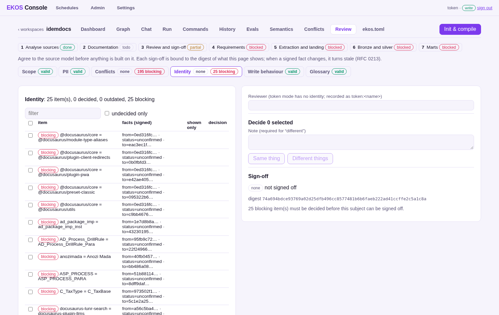

# 4. Step 3 — Review and sign-off

Before anything is built on the source model, a person agrees to it. EKOS computes six review subjects from the
ledger; the person decides items and signs each subject off **on the digest of what was shown**. A sign-off stays
valid only while those facts are unchanged — validity is recomputed every time it is read.

| Subject | Items | Decided where |
|---|---|---|
| scope | 903 tables, classed by name rules | Review page / `ekos review scope` |
| pii | 196 candidate columns | Review page / `ekos review pii` (with a mask: hash, redact, none) |
| conflicts | 429 code ↔ database disagreements (195 open and unexplained) | Conflicts page / `ekos conflicts resolve` |
| identity | 1 candidate match (`anozimada` = `Anozi Mada`; 25 before EKOS RFC 0224 stopped proposing a table and its child, or two packages of one scope) | Review page / `ekos review identity` |
| write-behaviour | 850 tables: how rows are updated and deleted, change log | Review page / `ekos review write-behaviour` |
| glossary | business definitions (`[semantics]` off here: 0) | Semantics page |

State at the end of this demo ([`review-list.json`](../results/review/review-list.json),
[`workflow-status.json`](../results/review/workflow-status.json)): scope, pii, write-behaviour and glossary
**signed**; conflicts and identity **blocked** (195 conflicts and 1 identity match for a person to decide). Steps 4–7
therefore show `blocked`.



**A sign-off going stale.** After `scope` and `pii` were signed, one column was added in Oracle
(`ALTER TABLE C_BPartner ADD (EKOS_Contact_EMail VARCHAR2(60))`) and the pipeline rerun: `pii` turned **stale —
1 added: `C_BPARTNER.EKOS_CONTACT_EMAIL`**, while `scope` stayed valid (a column count is shown, not signed). In the
browser walk-through a scope decision (`I_PRODUCT` out) turned the scope sign-off stale naming `I_PRODUCT`, and it was
signed again.



**Signing** needs the subject's name typed and posts the digest the page showed; if anything changed in between,
EKOS refuses. Deciding and signing need the reviewer role, which no API token can hold, and no MCP tool can decide
or sign — agents can read the state (`ekos_signoff_status`).



On the command line:

```bash
ekos review list
ekos review show pii --undecided
ekos review pii AD_ORGINFO.EMAIL --confirm --mask hash
ekos signoff show pii                       # prints the digest
ekos signoff approve pii --digest <digest>
ekos workflow status                        # the seven-step bar
```

[`scripts/review_tour.py`](../../scripts/review_tour.py) is the browser walk-through (Playwright, 18 checks).
