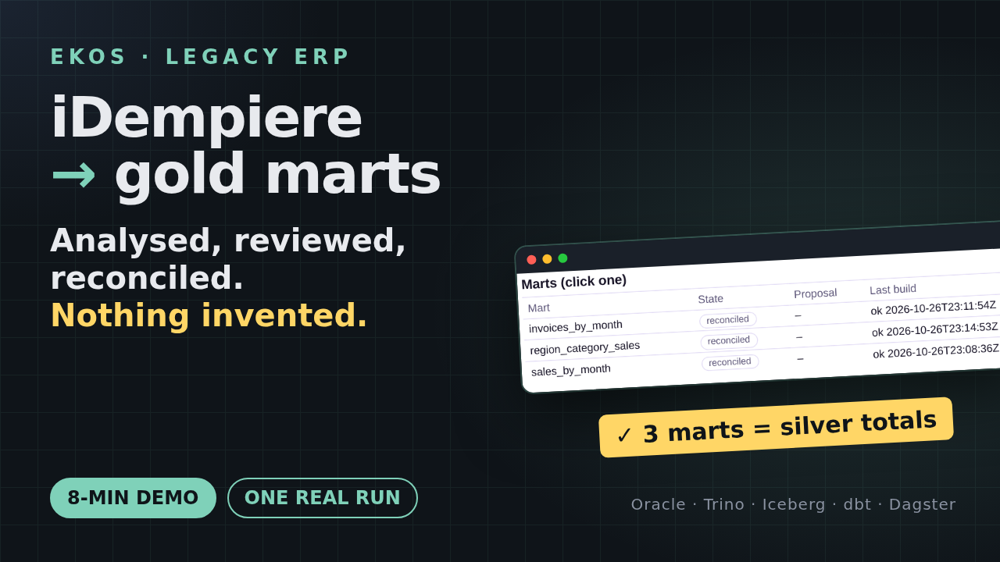

# The video: iDempiere, from analysis to reconciled marts

[](https://github.com/alexeyban/ekos-lakehouse-oracle/releases/tag/video-2026-10-27)

**[Watch: `ekos-idempiere-end-to-end.mp4`](https://github.com/alexeyban/ekos-lakehouse-oracle/releases/tag/video-2026-10-27)**
(7:52, 1920×1080, narrated, [subtitles](ekos-idempiere-end-to-end.srt)). This is one real run on 2026-10-26/27.

A new project, `idemsales`, on the same iDempiere/Oracle testbed, went through the seven steps in the EKOS console.
Step 3 scoped it to the order-to-invoice slice: 33 tables, loaded completely through Dagster, plus three gold marts
reconciled against silver. A demo operator made the review decisions, each with its reason. Every screen in the video
is from this run, and every number spoken is on screen. The [run log](RUNLOG.md) keeps what went wrong, including two
product defects found and fixed during the recording (EKOS RFC 0231; lakehouse-docs lineage on upper-case names).

| | |
|---|---|
| [`RUNBOOK.md`](RUNBOOK.md) | how to record it live or re-take a scene: checklist, clicks per scene, expected screens |
| [`RUNLOG.md`](RUNLOG.md) | what happened during this recording, with times |
| [`shots/`](shots/) | the console, Dagster and dbt docs screenshots (1920×1080; `-tileN` are crops of long pages) |
| [`diagrams/`](diagrams/) | the code map, the slice's ER, column lineage per mart, the architecture, drawn from compiled facts and the generated pipeline, never by hand |
| [`steps/`](steps/) | the 13 scenes: title, shots, narration (the WAVs and image copies are rebuilt) |
| [`descriptions.md`](descriptions.md) | YouTube / LinkedIn / X texts with chapters |
| [`../pipeline-sales/`](../pipeline-sales/) | this project's generated pipeline: 33 bronze tables, silver and the three marts in dbt, Dagster, and its [history](../pipeline-sales/HISTORY.md) |

## The scenes

| Time | Scene | Diagrams and screens |
|---|---|---|
| 0:00 | EKOS on a legacy ERP | title card |
| 0:42 | The estate: code and database | [code map](diagrams/project-map.png), [source ER of the slice](diagrams/source-er-keys.png) |
| 1:15 | Step 1: analyse the sources | Sources, Init & compile (0 model calls), census = compiled |
| 1:58 | Step 2: documentation | Documentation page, preview, 239 pages published |
| 2:29 | Step 3: review, scope | 816 tables out with one command, the scope signed |
| 3:05 | Step 3: conflicts, identity, sign-off | 17 conflicts settled with measured counts, 6/6 signed |
| 3:40 | Step 5: the extraction plan | evidence per table, one change, approval |
| 4:16 | Generate, then step 4 | two marts from Markdown, one drafted from plain words |
| 4:56 | Step 4: the operator answers | unresolved terms answered, three requirements approved |
| 5:25 | Step 6: bronze and silver | Dagster: 36 steps, 895 checks |
| 6:06 | Step 7: marts | propose, merge, build, reconcile: totals equal |
| 6:42 | Models and lineage | dbt lineage, [column lineage](diagrams/lineage-region_category_sales.png) |
| 7:12 | What we got | the dashboard, recap |

## Rebuilding it

```bash
python video/tour.py <phase>          # screenshots from the console (see RUNBOOK.md)
python video/make_steps.py            # scenes from shots + narration
# narrated-demo-video skill: manifest.py → review.py → make_video.py (Piper TTS, ffmpeg)
```
